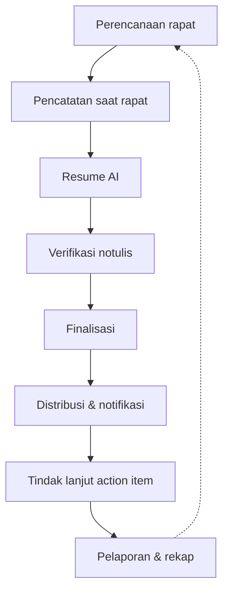
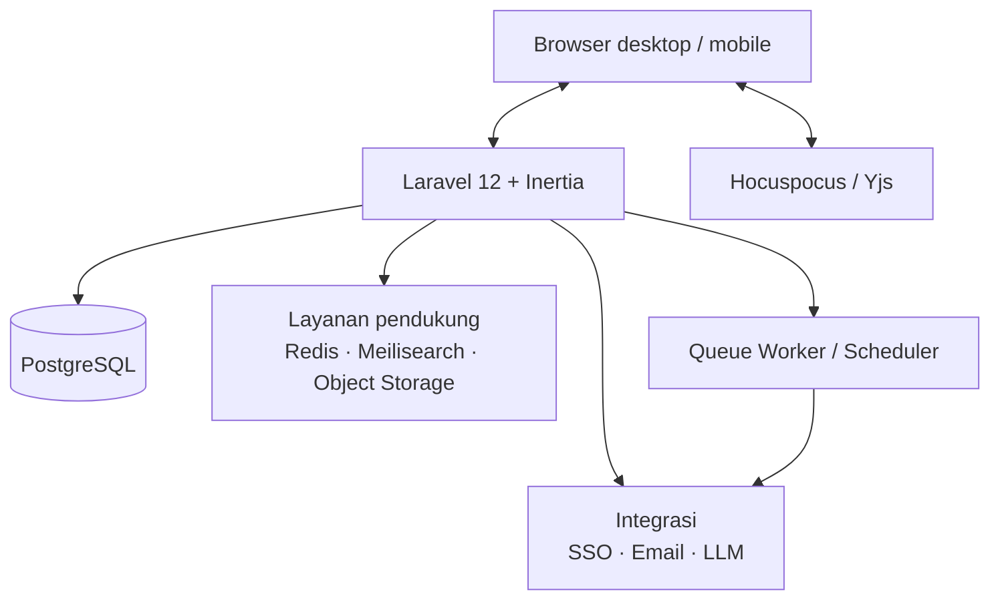

# PRD — Sistem Notulensi (MoM) Terintegrasi AI

**Kode dokumen:** DOC-PRD-MOM-001  
**Versi:** 1.0  
**Tanggal:** 26 Oktober 2026  
**Status:** Final draft untuk persetujuan  
**Pemilik produk:** Wafiq Lana Pradana  
**Reviewer:** Manager IT, Kepala Divisi Pilot  
**Approver:** Manajemen

> Dokumen ini adalah acuan produk untuk pembangunan Sistem Notulensi (Minutes of Meeting/MoM). Aspek komersial dan pembiayaan tidak dibahas dalam dokumen ini. Data model dijelaskan pada `02-ERD-Sistem-Notulensi.md`; alur kerja dijelaskan pada `03-Bisnis-Proses-Sistem-Notulensi.md`.

## Riwayat Versi

| Versi | Tanggal | Perubahan | Penyusun |
| --- | --- | --- | --- |
| 0.1 | 26 Okt 2026 | Draf awal kebutuhan produk | Wafiq Lana Pradana |
| 0.2 | 26 Okt 2026 | Penambahan rekomendasi tech stack | Wafiq Lana Pradana |
| 1.0 | 26 Okt 2026 | Konsolidasi PRD, ERD, bisnis proses, dan keputusan arsitektur | Wafiq Lana Pradana |

## 1. Ringkasan Eksekutif

Sistem Notulensi (MoM) adalah aplikasi web internal untuk mencatat, mendistribusikan, dan menindaklanjuti hasil rapat lintas divisi. Setiap notulen dapat menandai peserta, divisi, dan topik melalui `@orang`, `@divisi`, dan `#topik`, sehingga pihak terkait otomatis menerima notifikasi dan dapat menemukan kembali keputusan serta tugasnya.

Pengalaman menulis dibuat mirip Google Docs: teks kaya, tabel, daftar, lampiran, dan kolaborasi. Seluruh notulen terhubung ke layanan AI untuk menghasilkan ringkasan, daftar keputusan, usulan action item, saran tag, serta tanya-jawab lintas notulen. AI tidak pernah menjadi sumber kebenaran tunggal: notulis wajib memverifikasi sebelum notulen difinalkan.

**Keputusan arsitektur:** aplikasi custom (Opsi B) dengan pilot bertahap di 2–3 divisi. Pendekatan ini dipilih karena kebutuhan P0 — tagging lintas dokumen, hak akses granular, halaman "Terkait Saya", pencarian terfilter, dan pelacakan action item — tidak dapat dipenuhi secara konsisten di Google Workspace.

**Hasil yang diharapkan dalam 6 bulan:**

- ≥ 90% rapat resmi tercatat di sistem.
- 100% action item memiliki PIC dan tenggat.
- ≥ 80% action item selesai tepat waktu.
- ≥ 70% notulen memiliki resume AI yang dipakai.
- Seluruh divisi aktif menggunakan sistem.

## 2. Latar Belakang & Masalah

| Masalah | Dampak |
| --- | --- |
| Notulen tersebar di dokumen pribadi, chat, dan email | Sulit dicari kembali, tidak ada sumber tunggal, dan rawan hilang |
| Tidak ada kejelasan PIC dan tenggat action item | Tindak lanjut rapat terlewat |
| Keputusan rapat divisi lain tidak diketahui | Silo informasi dan pekerjaan duplikatif |
| Notulen panjang dan tidak seragam | Manajemen sulit membaca ringkasan cepat |
| Tagging dan pencarian lintas dokumen lemah | Notulen yang relevan tidak ditemukan saat dibutuhkan |
| Jejak akses dan perubahan tidak tercatat | Sulit diaudit dan dipertanggungjawabkan |

## 3. Tujuan & Metrik Keberhasilan

| Tujuan | Metrik | Baseline | Target 6 bulan | Sumber |
| --- | --- | --- | --- | --- |
| Notulen tersentralisasi | % rapat resmi tercatat | Belum diukur | ≥ 90% | Register notulen |
| Distribusi cepat | Waktu kirim ke peserta/tag | Manual | ≤ 24 jam | Log notifikasi |
| Tindak lanjut jelas | % action item punya PIC & tenggat | Belum diukur | 100% | Tabel action item |
| Penyelesaian tindak lanjut | % action item selesai tepat waktu | Belum diukur | ≥ 80% | Status action item |
| Efisiensi membaca | % notulen dengan resume AI yang dipakai | 0% | ≥ 70% | Log akses resume |
| Adopsi | Divisi aktif | 0 | Semua divisi | Pengguna aktif |
| Kualitas AI | % resume disetujui tanpa koreksi besar | Belum ada | ≥ 80% | Riwayat persetujuan |
| Kinerja | Waktu muat & pencarian | Belum diukur | ≤ 2 dtk / ≤ 3 dtk | APM/log server |

## 4. Ruang Lingkup

### 4.1 Termasuk

- Pembuatan dan penyuntingan notulen dari template.
- Tagging orang, divisi, dan topik pada level dokumen dan bagian tertentu.
- Halaman "Terkait Saya", halaman topik, halaman divisi, dan halaman orang.
- Pencarian teks penuh dengan filter tanggal, divisi, topik, orang, dan status.
- Tabel action item, board tindak lanjut, pengingat tenggat, dan rekap.
- Notifikasi email dan in-app.
- Resume AI, ekstraksi action item, saran tag, rekap lintas notulen, dan tanya-jawab sesuai hak akses.
- Administrasi pengguna, divisi, topik, peran, audit, dan retensi.
- Integrasi SSO, kalender, dan kanal chat pada fase lanjutan.

### 4.2 Tidak Termasuk

- Pengganti aplikasi video meeting atau kalender.
- Sistem manajemen proyek penuh; hanya pelacakan action item dari rapat.
- Transkripsi audio otomatis pada rilis awal (fase lanjutan).
- Aplikasi mobile native; antarmuka web responsif sudah mencakup ponsel.
- Pengadaan perangkat, lisensi, dan infrastruktur.
- Migrasi seluruh arsip lama; dilakukan bertahap bila diperlukan.
- Pembahasan komersial, pembiayaan, dan penawaran harga.

## 5. Persona & Peran

| Persona | Kebutuhan utama | Peran sistem |
| --- | --- | --- |
| Notulis | Template cepat, tagging mudah, tidak perlu format ulang | Admin atau Notulis |
| Peserta rapat | Menerima notulen dan melihat tugas sendiri | Anggota |
| Kepala divisi / manajer | Memantau keputusan dan tindak lanjut divisi | Anggota atau Notulis |
| Direksi / manajemen | Ringkasan lintas divisi dan topik strategis | Pembaca |
| Admin sistem (IT) | Kelola pengguna, divisi, hak akses, integrasi, audit | Admin |

## 6. Cerita Pengguna & Kriteria Penerimaan

| ID | Cerita pengguna | Kriteria penerimaan |
| --- | --- | --- |
| US-01 | Sebagai notulis, saya ingin membuat notulen dari template agar format seragam. | Notulis memilih template; judul, tanggal, agenda, peserta, dan bagian standar terisi otomatis; notulen tersimpan sebagai draf. |
| US-02 | Sebagai notulis, saya ingin men-tag peserta, divisi, dan topik dengan `@nama`, `@divisi`, dan `#topik`. | Mention tersimpan sebagai tag terstruktur; tag muncul di halaman terkait dan memicu notifikasi; duplikasi tag di dokumen yang sama digabung. |
| US-03 | Sebagai peserta, saya ingin menerima notifikasi saat di-tag dan melihat tugas saya. | Notifikasi in-app dan email terkirim setelah notulen difinalkan; halaman "Terkait Saya" menampilkan notulen dan tugas. |
| US-04 | Sebagai anggota divisi, saya ingin melihat notulen yang menyebut divisi saya. | Notulen dengan tag divisi terlihat oleh anggota divisi sesuai tingkat kerahasiaan. |
| US-05 | Sebagai manajer, saya ingin melihat keputusan terkait satu topik lintas divisi. | Halaman topik menampilkan notulen, keputusan, dan action item lintas divisi. |
| US-06 | Sebagai pengguna, saya ingin AI merangkum notulen panjang. | Resume berisi ringkasan, poin penting, keputusan, dan usulan action item; berlabel "dibuat AI" dan dapat disunting. |
| US-07 | Sebagai pengguna, saya ingin bertanya ke AI tentang keputusan bulan ini. | AI hanya memakai notulen yang boleh diakses penanya; jawaban menautkan sumber. |
| US-08 | Sebagai admin, saya ingin mengatur siapa boleh melihat notulen tertentu. | Admin menetapkan tingkat kerahasiaan; akses diuji terhadap peran, peserta, tag, dan divisi. |
| US-09 | Sebagai PIC, saya ingin memperbarui status tugas saya. | PIC dapat mengubah status tugasnya; perubahan tercatat di audit log. |
| US-10 | Sebagai notulis, saya ingin memfinalkan notulen setelah verifikasi. | Finalisasi mengunci versi, mencatat waktu dan approver, dan mencegah penyuntingan non-admin. |
| US-11 | Sebagai manajer, saya ingin rekap mingguan/bulanan per divisi. | Rekap dibuat AI dari notulen yang berhak diakses dan dapat diekspor. |
| US-12 | Sebagai admin, saya ingin melihat jejak akses dan perubahan. | Audit log mencatat aktor, aksi, waktu, IP, dan objek terkait. |

## 7. Kebutuhan Fungsional

Prioritas: **P0** wajib rilis awal, **P1** penting, **P2** fase lanjutan.

### 7.1 Pembuatan & Penyuntingan Notulen

| ID | Kebutuhan | Prioritas | Kriteria penerimaan |
| --- | --- | --- | --- |
| F-01 | Editor dokumen kaya (teks, tabel, daftar, lampiran) | P0 | Mendukung heading, bold/italic, daftar, tabel, tautan, dan gambar/lampiran; konten tersimpan sebagai JSON. |
| F-02 | Template notulen standar | P0 | Template memuat judul, tanggal, waktu, lokasi/link, agenda, peserta, pembahasan, keputusan, action item. |
| F-03 | Template per jenis rapat | P1 | Template dapat dibedakan untuk harian, mingguan, divisi, lintas divisi, dan manajemen. |
| F-04 | Kolaborasi real-time & riwayat versi | P0 | Dua notulis dapat menyunting bersamaan tanpa konflik; versi tersimpan dan dapat dipulihkan. |
| F-05 | Tabel action item bergaya spreadsheet | P0 | Kolom tugas, PIC, tenggat, status; dapat diubah dari halaman notulen. |
| F-06 | Draf, final, dan penguncian | P1 | Status draf → final → terkunci; hanya admin dapat menyunting setelah final. |
| F-07 | Lampiran file dan tautan | P1 | Berkas disimpan di object storage; tautan eksternal dapat ditambahkan. |
| F-08 | Ekspor PDF dan Word | P1 | Ekspor mengikuti hak akses dan menampilkan label kerahasiaan. |

### 7.2 Tagging

| ID | Kebutuhan | Prioritas | Kriteria penerimaan |
| --- | --- | --- | --- |
| F-10 | Tag orang `@nama` | P0 | Mention menyimpan ID pengguna dan label; muncul di halaman terkait. |
| F-11 | Tag divisi `@divisi` | P0 | Mention divisi mencakup seluruh anggota divisi untuk notifikasi dan akses. |
| F-12 | Tag topik `#topik` | P0 | Topik terkelola admin; mention topik menghubungkan notulen ke halaman topik. |
| F-13 | Tag pada level dokumen atau bagian | P1 | Tag dapat menyimpan posisi/rentang di dokumen. |
| F-14 | Notifikasi dan halaman terkait | P0 | Setiap tag menghasilkan notifikasi dan entri "Terkait Saya". |
| F-15 | Banyak tag sekaligus | P0 | Satu notulen dapat memiliki kombinasi orang, divisi, dan topik. |
| F-16 | Tamu eksternal | P2 | Nama tamu dapat di-tag tanpa akun; opsi kirim email. |

### 7.3 Pencarian, Filter & Tampilan

| ID | Kebutuhan | Prioritas | Kriteria penerimaan |
| --- | --- | --- | --- |
| F-20 | Halaman "Terkait Saya" | P0 | Menampilkan notulen dan tugas yang menyebut pengguna/divisinya. |
| F-21 | Halaman topik | P0 | Menampilkan notulen, keputusan, dan tugas untuk satu topik lintas divisi. |
| F-22 | Halaman divisi dan orang | P1 | Menampilkan notulen dan tugas per divisi/orang sesuai akses. |
| F-23 | Pencarian teks penuh + filter | P0 | Filter tanggal, divisi, topik, orang, status; hasil ≤ 3 detik. |
| F-24 | Board action item | P1 | Tampilan daftar/kanban dengan filter PIC, divisi, dan tenggat. |
| F-25 | Dashboard ringkasan | P2 | Rapat bulan ini, tugas terlambat, topik terbanyak. |

### 7.4 Notifikasi & Tindak Lanjut

| ID | Kebutuhan | Prioritas | Kriteria penerimaan |
| --- | --- | --- | --- |
| F-30 | Notifikasi email dan in-app | P0 | Terkirim saat di-tag, diberi tugas, atau notulen difinalkan. |
| F-31 | Pengingat H-3, H-1, dan terlambat | P1 | Scheduler mengirim pengingat; status tugas diperbarui otomatis. |
| F-32 | Integrasi chat perusahaan | P2 | Notifikasi dapat dikirim ke WhatsApp/Slack/Teams sesuai kebijakan. |
| F-33 | Integrasi kalender | P1 | Menarik jadwal dan peserta dari undangan kalender. |
| F-34 | Rekap mingguan otomatis | P1 | Rekap per orang dan kepala divisi dikirim sesuai jadwal. |

### 7.5 Fitur AI

| ID | Kebutuhan | Prioritas | Kriteria penerimaan |
| --- | --- | --- | --- |
| F-40 | Resume otomatis per notulen | P0 | Menghasilkan ringkasan, poin penting, dan keputusan; berlabel AI. |
| F-41 | Ekstraksi action item | P0 | Menghasilkan tugas, PIC, dan tenggat; notulis mengonfirmasi sebelum disimpan. |
| F-42 | Saran tag | P1 | Menyarankan orang, divisi, dan topik berdasarkan isi. |
| F-43 | Resume lintas notulen | P1 | Rekap per topik/divisi/periode. |
| F-44 | Tanya-jawab atas notulen | P1 | Jawaban hanya dari notulen yang boleh diakses; menautkan sumber. |
| F-45 | Resume per peran | P2 | Versi singkat untuk direksi dan versi detail untuk tim. |
| F-46 | Transkripsi rekaman | P2 | Rekaman menjadi draf notulen. |
| F-47 | Penerjemahan resume | P2 | Indonesia–Inggris. |

### 7.6 Administrasi

| ID | Kebutuhan | Prioritas | Kriteria penerimaan |
| --- | --- | --- | --- |
| F-50 | Manajemen pengguna, divisi, peran, SSO | P0 | Admin dapat mengubah peran/divisi; SSO tersedia untuk produksi. |
| F-51 | Manajemen topik | P1 | Buat, gabung, arsipkan topik; mencegah duplikasi. |
| F-52 | Audit log | P1 | Mencatat siapa melihat, mengubah, dan memfinalkan notulen. |
| F-53 | Retensi dan arsip | P2 | Kebijakan retensi dapat dikonfigurasi. |

## 8. Aturan Bisnis

| ID | Aturan |
| --- | --- |
| BR-01 | Notulen baru berstatus `draft`; hanya pembuat, notulis, atau admin yang dapat menyunting draf. |
| BR-02 | Finalisasi mengubah status menjadi `final`, mengisi `finalized_at` dan `approved_by`, serta mencatat audit. |
| BR-03 | Setelah final, penyuntingan hanya boleh dilakukan admin dan tetap tercatat di audit log. |
| BR-04 | Status `locked` tidak dapat disunting oleh siapa pun kecuali melalui prosedur admin. |
| BR-05 | Visibilitas mengikuti tingkat kerahasiaan: terbuka, divisi, terbatas, rahasia. |
| BR-06 | Notulen rahasia hanya terlihat oleh peserta, pembuat, dan admin yang ditunjuk; tag tidak membuka akses. |
| BR-07 | Tag orang/divisi/topik disinkronkan dari mention di editor; duplikat dalam satu notulen digabung. |
| BR-08 | Tag divisi mencakup seluruh anggota divisi untuk notifikasi, tetapi akses tetap mengikuti kerahasiaan. |
| BR-09 | Action item wajib memiliki judul; PIC dan tenggat wajib diisi sebelum notulen final. |
| BR-10 | Status action item: `new`, `in_progress`, `done`, `cancelled`; `overdue` dihitung dari tenggat, bukan status tersimpan. |
| BR-11 | Hanya PIC, notulis, atau admin yang dapat mengubah status action item. |
| BR-12 | Resume AI berstatus `draft` sampai disetujui notulis; AI tidak boleh memfinalkan notulen. |
| BR-13 | AI hanya memakai notulen yang boleh diakses penanya; notulen rahasia dikecualikan kecuali disetujui eksplisit. |
| BR-14 | Semua hasil AI wajib berlabel "dibuat AI" dan menautkan sumber. |
| BR-15 | Notifikasi tidak boleh dikirim ke pihak yang tidak berhak melihat notulen. |
| BR-16 | Perubahan peran, divisi, dan status pengguna dicatat di audit log. |
| BR-17 | Penghapusan notulen menggunakan soft delete; pemulihan dilakukan admin. |

## 9. Model Data Ringkas

Detail lengkap ada di `02-ERD-Sistem-Notulensi.md`.

| Entitas | Fungsi |
| --- | --- |
| `users` | Pengguna, peran, divisi, status aktif |
| `divisions` | Divisi dan kepala divisi |
| `topics` | Topik terkelola |
| `meeting_templates` | Template notulen per jenis rapat |
| `meetings` | Notulen, isi dokumen, status, kerahasiaan |
| `meeting_participants` | Peserta dan kehadiran |
| `tags` | Mention orang/divisi/topik beserta posisi |
| `decisions` | Keputusan rapat dan topik terkait |
| `action_items` | Tugas, PIC, tenggat, status |
| `ai_summaries` | Resume AI per notulen/topik/divisi/periode |
| `attachments` | Berkas, tautan, rekaman |
| `audit_logs` | Jejak akses dan perubahan |
| `notifications` | Notifikasi in-app per pengguna |

## 10. Ringkasan Bisnis Proses

Detail alur, swimlane, state machine, dan RACI ada di `03-Bisnis-Proses-Sistem-Notulensi.md`.

| Proses | Aktor utama | Output |
| --- | --- | --- |
| Perencanaan & pembuatan notulen | Notulis, Sistem | Draf notulen + peserta + agenda |
| Pencatatan rapat | Notulis | Isi notulen, tag, keputusan, action item |
| Resume AI & verifikasi | Notulis, AI | Resume dan usulan tugas yang terverifikasi |
| Finalisasi & distribusi | Notulis, Sistem | Notulen final + notifikasi |
| Tindak lanjut | PIC, Sistem | Status tugas dan pengingat |
| Pelaporan | Manajer, AI | Rekap mingguan/bulanan |
| Administrasi & audit | Admin | Pengguna, topik, divisi, audit |

## 11. Integrasi AI

### 11.1 Pendekatan

Notulen berstatus draf atau final dikirim ke layanan LLM melalui API. Hasil disimpan sebagai resume yang dapat disunting dan disetujui notulis. Pemrosesan dilakukan asinkron melalui queue agar tidak memblokir permintaan pengguna.

### 11.2 Keluaran AI

- Ringkasan singkat.
- Poin pembahasan penting.
- Daftar keputusan.
- Usulan action item: tugas, PIC, tenggat.
- Saran tag: orang, divisi, topik.
- Rekap lintas notulen per topik/divisi/periode.
- Jawaban tanya-jawab dengan sitasi sumber.

### 11.3 Guardrail

| Guardrail | Implementasi |
| --- | --- |
| Manusia memverifikasi | Status `draft` sampai notulis menyetujui |
| Hak akses dihormati | Query AI dibatasi `Meeting::visibleTo(user)` |
| Transparan | Label "dibuat AI" dan tautan sumber |
| Data tidak untuk pelatihan | Penyedia AI wajib memiliki kebijakan no-training |
| Notulen sensitif | Dapat dikecualikan dari pemrosesan AI |
| Kegagalan layanan | Job retry, fallback tanpa AI, notifikasi admin |
| Kuota pemakaian AI | Kuota dan pemantauan token per divisi |

## 12. Hak Akses & Keamanan

### 12.1 Tingkat Kerahasiaan

| Tingkat | Siapa yang dapat melihat | AI |
| --- | --- | --- |
| Terbuka | Seluruh pengguna terautentikasi | Boleh, dengan label AI |
| Divisi | Anggota divisi yang di-tag dan peserta | Boleh untuk pengguna berhak |
| Terbatas | Peserta dan orang yang di-tag | Hanya jika penanya berhak |
| Rahasia | Peserta tertentu dan admin yang ditunjuk | Dikecualikan kecuali disetujui eksplisit |

### 12.2 Matriks Peran

| Fungsi | Admin | Notulis | Kepala Divisi | Peserta | Pembaca |
| --- | --- | --- | --- | --- | --- |
| Dashboard | ✓ | ✓ | ✓ | ✓ | ✓ |
| Buat/sunting draf | ✓ | ✓ | – | – | – |
| Finalkan | ✓ | ✓ | – | – | – |
| Sunting setelah final | ✓ | – | – | – | – |
| Lihat sesuai kerahasiaan | ✓ | ✓ | ✓ | ✓ | ✓ |
| Update status tugas | ✓ | ✓ | PIC | PIC | – |
| Kelola topik/divisi/pengguna | ✓ | – | – | – | – |
| Audit log | ✓ | – | – | – | – |
| Tanya AI | ✓ | ✓ | ✓ | ✓ | ✓ |

### 12.3 Keamanan

- SSO perusahaan dan opsi MFA.
- Enkripsi saat transit dan saat disimpan.
- Password di-hash; token sesi dikelola framework.
- Otorisasi di level policy dan query, bukan hanya UI.
- Audit log untuk akses dan perubahan.
- Backup harian dan uji restore berkala.
- Notulen sensitif mengikuti kebijakan perlindungan data perusahaan dan UU Pelindungan Data Pribadi.

## 13. Kebutuhan Non-Fungsional

| Aspek | Kebutuhan |
| --- | --- |
| Kinerja | Halaman ≤ 2 detik; pencarian ≤ 3 detik; resume AI ≤ 60 detik untuk notulen standar |
| Ketersediaan | ≥ 99,5% pada jam kerja |
| Skalabilitas | Seluruh karyawan dan ribuan notulen per tahun |
| Kegunaan | Responsif desktop/ponsel; bahasa antarmuka Indonesia |
| Kolaborasi | Penyuntingan bersama tanpa konflik; riwayat versi |
| Keandalan | Backup harian; pemulihan maksimal 24 jam |
| Kepatuhan | Jejak audit; retensi sesuai kebijakan |
| Aksesibilitas | Kontras memadai, navigasi keyboard, label form |
| Observabilitas | Log terpusat, monitoring queue, alert kegagalan AI |

## 14. Arsitektur & Tech Stack

### 14.1 Keputusan Arsitektur

Aplikasi dibangun sebagai monolit modular Laravel dengan frontend Vue 3 melalui Inertia. Pendekatan ini menghindari API terpisah untuk kebutuhan internal, mempercepat pengembangan, dan tetap memungkinkan pemisahan layanan ketika skala meningkat.

### 14.2 Tech Stack

| Lapisan | Teknologi | Alasan |
| --- | --- | --- |
| Backend | PHP 8.4 + Laravel 12 | Ekosistem auth, policy, queue, scheduler, notifikasi |
| Frontend | Vue 3 + TypeScript | Kurva belajar landai untuk tim PHP, tipe aman |
| Jembatan | Inertia.js 2 | Render dari controller tanpa API terpisah |
| Styling | Tailwind CSS | Konsisten dan mudah dikustom |
| Komponen UI | shadcn-vue | Aksesibel, dapat dimodifikasi |
| Editor | Tiptap 2 | Mention, tabel, ekstensi kaya |
| Kolaborasi | Yjs + Hocuspocus | Sinkronisasi real-time dan presence |
| Database | PostgreSQL 16+ | JSONB untuk dokumen, pgvector untuk AI |
| Pencarian | Meilisearch + Scout | Toleran salah ketik, filter facet |
| Queue | Laravel Queue + Redis | AI/notifikasi asinkron |
| Scheduler | Laravel Scheduler | Pengingat dan rekap |
| AI | LLM API provider-agnostik | Mudah mengganti penyedia |
| Auth | Fortify + SSO + MFA | Sesuai kebijakan perusahaan |
| Storage | S3-compatible | Lampiran dan rekaman |
| Deployment | Docker Compose + Nginx | Konsisten lokal dan produksi |

### 14.3 Lingkungan

| Lingkungan | Tujuan | Data |
| --- | --- | --- |
| Local | Pengembangan | Data demo |
| Staging | UAT dan pelatihan | Data sintetis |
| Production | Operasional | Data perusahaan |

## 15. Rencana Rilis

| Fase | Cakupan | Durasi | Milestone |
| --- | --- | --- | --- |
| Fase 0 — Discovery | Wawancara divisi, contoh notulen, daftar divisi/topik, kebijakan data | 1 minggu | Peta proses disetujui |
| Fase 1 — MVP & Pilot | Template, tagging, action item, notifikasi, resume AI, pilot 2–3 divisi | 10 minggu | Go-live pilot (W10) |
| Fase 2 — Perluasan | Semua divisi, Terkait Saya, halaman topik, pengingat, rekap, Q&A | 7 minggu | Full rollout (W16) |
| Fase 3 — Penyempurnaan | Kalender, chat, transkripsi, penerjemahan, evaluasi | 2 minggu | Evaluasi manfaat (W18) |

> Jadwal bersifat indikatif dan bergantung pada kesiapan SSO, kebijakan AI, dan partisipasi divisi pilot.

## 16. Risiko & Mitigasi

| Risiko | Dampak | Mitigasi | Owner |
| --- | --- | --- | --- |
| Notulis tidak disiplin mengisi | Data tidak lengkap | Template sederhana, sasaran kepatuhan, dukungan manajemen | Product Owner |
| Resume AI keliru | Salah informasi | Verifikasi manusia, sitasi sumber, label AI | Tech Lead |
| Kebocoran data sensitif | Risiko hukum/reputasi | Klasifikasi, policy, pengecualian AI, audit | Manager IT |
| Notifikasi berlebihan | Pengguna mengabaikan | Preferensi, rekap gabungan, batching | Product Owner |
| Topik duplikat | Pencarian tidak akurat | Topik terkelola, saran AI, review berkala | Admin |
| Adopsi rendah | Sistem tidak dipakai | Pilot, pelatihan, champion divisi | Product Owner |
| Scope creep | Rilis mundur | Scope P0 dikunci, change request formal | Manager IT |
| Ketergantungan layanan Node/Meilisearch | Fitur terganggu | Health check, fallback pencarian, runbook | Tech Lead |
| SSO belum siap | Login terhambat | Fallback login lokal + MFA, jadwal integrasi | Manager IT |
| Kehilangan data | Operasional terganggu | Backup harian, uji restore, retensi | Manager IT |

## 17. Pertanyaan Terbuka

1. Berapa jumlah divisi dan karyawan yang akan menggunakan sistem?
2. Apakah perusahaan memakai Google Workspace, Microsoft 365, atau keduanya?
3. Siapa yang menjadi notulis: sekretaris, anggota bergilir, atau siapa saja?
4. Apakah ada rapat dengan data sensitif yang tidak boleh diproses AI eksternal?
5. Penyedia AI mana yang diizinkan dan di mana data boleh diproses?
6. Saluran notifikasi utama: email, WhatsApp, atau chat perusahaan?
7. Apakah perlu dukungan notulen campuran Indonesia–Inggris?
8. Kebijakan retensi notulen dan rekaman?
9. Siapa admin yang ditunjuk untuk notulen rahasia?
10. Apakah kalender perusahaan menggunakan Google atau Microsoft?

## 18. Persetujuan

| Peran | Nama | Tanda tangan / Tanggal |
| --- | --- | --- |
| Pemilik Produk | Wafiq Lana Pradana | |
| Perwakilan Divisi | | |
| IT / Pengembang | | |
| Manajemen | | |

## Lampiran A — Glosarium

| Istilah | Arti |
| --- | --- |
| MoM | Minutes of Meeting / notulen rapat |
| Notulis | Pengguna yang menulis dan memfinalkan notulen |
| Tag | Penanda orang, divisi, atau topik di dalam notulen |
| Mention | Tag yang disisipkan di editor |
| Action item | Tugas tindak lanjut dari rapat |
| PIC | Person in Charge |
| Resume AI | Ringkasan yang dihasilkan model bahasa |
| Scout | Lapisan pencarian Laravel |
| Hocuspocus | Layanan sinkronisasi Yjs untuk kolaborasi |
| SSO | Single Sign-On |
