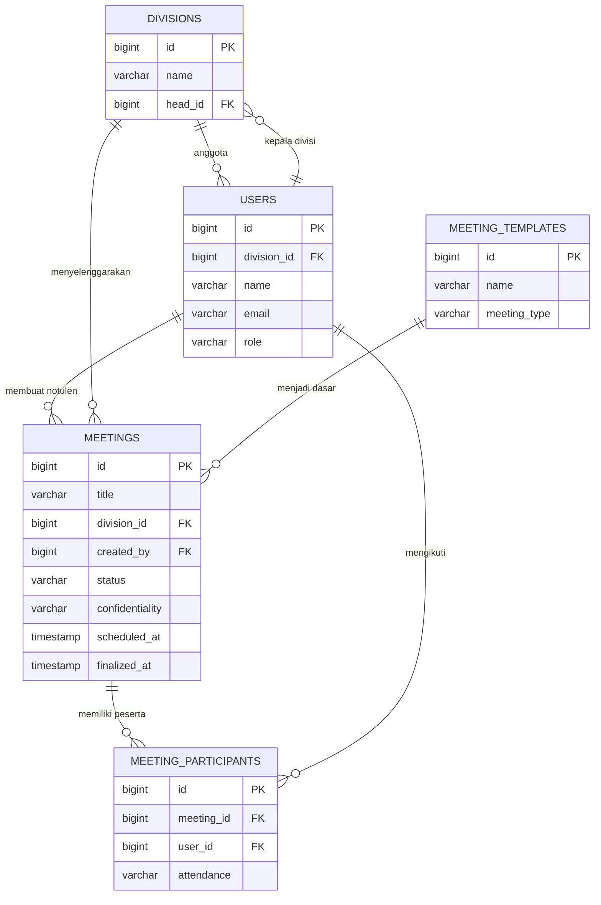
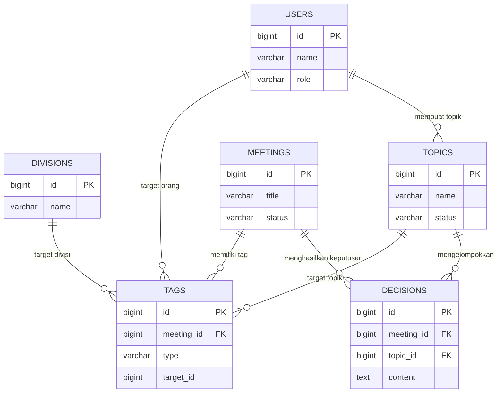
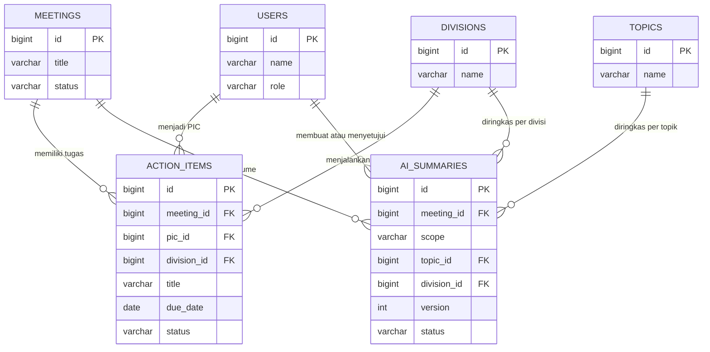
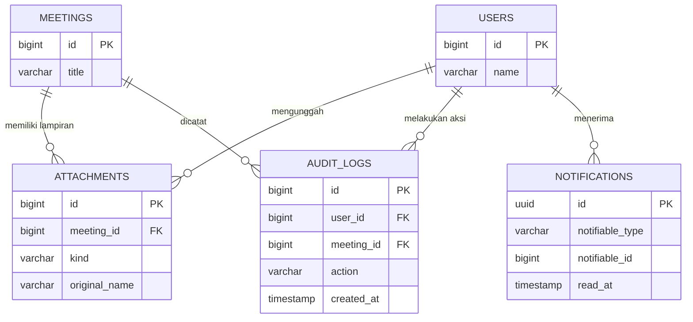

# ERD & Kamus Data — Sistem Notulensi (MoM)

**Kode dokumen:** DOC-ERD-MOM-001  
**Versi:** 1.0  
**Tanggal:** 26 Oktober 2026  
**Status:** Final draft  
**Acuan:** `01-PRD-Sistem-Notulensi.md`  
**Implementasi:** migrasi Laravel pada `database/migrations`

## 1. Tujuan & Ruang Lingkup

Dokumen ini menjelaskan model data Sistem Notulensi secara lengkap: entitas, relasi, kardinalitas, kamus data, indeks, enum, siklus hidup data, dan aturan akses di level data. Diagram menggunakan notasi crow's foot. Kamus data mengikuti skema PostgreSQL yang berjalan.

Ruang lingkup mencakup 13 tabel domain:

`users`, `divisions`, `topics`, `meeting_templates`, `meetings`, `meeting_participants`, `tags`, `decisions`, `action_items`, `ai_summaries`, `attachments`, `audit_logs`, `notifications`.

Tabel infrastruktur Laravel (`sessions`, `cache`, `jobs`, `failed_jobs`, `password_reset_tokens`) tidak dibahas karena bukan domain produk.

## 2. Notasi

| Simbol | Arti |
| --- | --- |
| `||--o{` | Satu ke banyak (opsional di sisi kanan) |
| `||--||` | Satu ke satu |
| `}o--o{` | Banyak ke banyak |
| `PK` | Primary key |
| `FK` | Foreign key |
| `UK` | Unique key |
| `jsonb` | Dokumen JSON terindeks PostgreSQL |

Catatan: `tags.target_id` dan `notifications.notifiable_*` bersifat polimorfik, sehingga tidak memiliki foreign key fisik. Relasinya dijaga di level aplikasi.

## 3. ERD Inti

### 3.1 Identitas, Rapat, dan Peserta

### 3.2 Tagging dan Keputusan

## 4. ERD Eksekusi

### 4.1 Tugas & Resume AI

### 4.2 Lampiran, Audit & Notifikasi

## 5. Katalog Entitas

| Entitas | Deskripsi | Sumber utama |
| --- | --- | --- |
| `users` | Pengguna sistem, peran, divisi, status aktif | SSO / admin |
| `divisions` | Struktur divisi dan kepala divisi | Admin |
| `topics` | Taksonomi topik lintas divisi | Admin |
| `meeting_templates` | Template notulen per jenis rapat | Admin/notulis |
| `meetings` | Notulen, isi dokumen, status, kerahasiaan | Notulis |
| `meeting_participants` | Peserta internal/eksternal dan kehadiran | Notulis/kalender |
| `tags` | Mention orang/divisi/topik | Editor |
| `decisions` | Keputusan rapat | Notulis |
| `action_items` | Tugas tindak lanjut | Notulis/AI |
| `ai_summaries` | Resume dan rekap AI | Layanan AI |
| `attachments` | Berkas, tautan, rekaman | Notulis |
| `audit_logs` | Jejak akses dan perubahan | Aplikasi |
| `notifications` | Notifikasi in-app | Aplikasi |

## 6. Kamus Data

### 6.1 `users`

| Kolom | Tipe | Null | Default | Keterangan |
| --- | --- | --- | --- | --- |
| `id` | bigint | Tidak | sequence | PK |
| `division_id` | bigint | Ya | – | FK ke `divisions.id`, `nullOnDelete` |
| `name` | varchar(255) | Tidak | – | Nama lengkap |
| `email` | varchar(255) | Tidak | – | UK; identitas login |
| `email_verified_at` | timestamp | Ya | – | Waktu verifikasi email |
| `password` | varchar(255) | Tidak | – | Hash password |
| `remember_token` | varchar(100) | Ya | – | Token remember me |
| `role` | varchar(255) | Tidak | `member` | `admin`, `notulis`, `member`, `reader` |
| `job_title` | varchar(255) | Ya | – | Jabatan |
| `is_active` | boolean | Tidak | `true` | Status aktif |
| `last_login_at` | timestamp | Ya | – | Login terakhir |
| `created_at` | timestamp | Ya | – | Waktu dibuat |
| `updated_at` | timestamp | Ya | – | Waktu diubah |

Indeks: `email` unik, `division_id`, `role`.

### 6.2 `divisions`

| Kolom | Tipe | Null | Default | Keterangan |
| --- | --- | --- | --- | --- |
| `id` | bigint | Tidak | sequence | PK |
| `name` | varchar(255) | Tidak | – | UK; nama divisi |
| `slug` | varchar(255) | Tidak | – | UK; slug URL |
| `description` | text | Ya | – | Deskripsi |
| `head_id` | bigint | Ya | – | FK ke `users.id`, `nullOnDelete` |
| `created_at` | timestamp | Ya | – | Waktu dibuat |
| `updated_at` | timestamp | Ya | – | Waktu diubah |

Indeks: `name` unik, `slug` unik, `head_id`.

### 6.3 `topics`

| Kolom | Tipe | Null | Default | Keterangan |
| --- | --- | --- | --- | --- |
| `id` | bigint | Tidak | sequence | PK |
| `name` | varchar(255) | Tidak | – | UK; nama topik |
| `slug` | varchar(255) | Tidak | – | UK; slug URL |
| `description` | text | Ya | – | Deskripsi |
| `status` | varchar(255) | Tidak | `active` | `active` atau `archived` |
| `created_by` | bigint | Ya | – | FK ke `users.id`, `nullOnDelete` |
| `created_at` | timestamp | Ya | – | Waktu dibuat |
| `updated_at` | timestamp | Ya | – | Waktu diubah |

Indeks: `name` unik, `slug` unik, `status`.

### 6.4 `meeting_templates`

| Kolom | Tipe | Null | Default | Keterangan |
| --- | --- | --- | --- | --- |
| `id` | bigint | Tidak | sequence | PK |
| `name` | varchar(255) | Tidak | – | Nama template |
| `meeting_type` | varchar(255) | Tidak | `other` | Jenis rapat |
| `description` | text | Ya | – | Deskripsi |
| `sections` | jsonb | Ya | – | Struktur bagian template |
| `is_active` | boolean | Tidak | `true` | Status aktif |
| `created_at` | timestamp | Ya | – | Waktu dibuat |
| `updated_at` | timestamp | Ya | – | Waktu diubah |

Indeks: `meeting_type`.

### 6.5 `meetings`

| Kolom | Tipe | Null | Default | Keterangan |
| --- | --- | --- | --- | --- |
| `id` | bigint | Tidak | sequence | PK |
| `title` | varchar(255) | Tidak | – | Judul rapat |
| `meeting_type` | varchar(255) | Tidak | `other` | Jenis rapat |
| `meeting_template_id` | bigint | Ya | – | FK ke `meeting_templates.id`, `nullOnDelete` |
| `division_id` | bigint | Ya | – | FK ke `divisions.id`, `nullOnDelete` |
| `created_by` | bigint | Tidak | – | FK ke `users.id`, `cascadeOnDelete` |
| `scheduled_at` | timestamp | Ya | – | Jadwal rapat |
| `started_at` | timestamp | Ya | – | Mulai aktual |
| `ended_at` | timestamp | Ya | – | Selesai aktual |
| `location` | varchar(255) | Ya | – | Lokasi |
| `meeting_link` | varchar(255) | Ya | – | Tautan rapat daring |
| `agenda` | text | Ya | – | Agenda |
| `content` | jsonb | Ya | – | Dokumen editor (ProseMirror JSON) |
| `content_text` | text | Ya | – | Teks datar untuk pencarian/analitik |
| `status` | varchar(255) | Tidak | `draft` | `draft`, `final`, `locked` |
| `confidentiality` | varchar(255) | Tidak | `division` | `open`, `division`, `restricted`, `secret` |
| `finalized_at` | timestamp | Ya | – | Waktu finalisasi |
| `approved_by` | bigint | Ya | – | FK ke `users.id`, `nullOnDelete` |
| `created_at` | timestamp | Ya | – | Waktu dibuat |
| `updated_at` | timestamp | Ya | – | Waktu diubah |
| `deleted_at` | timestamp | Ya | – | Soft delete |

Indeks: `(status, scheduled_at)`, `(division_id, scheduled_at)`, `meeting_type`, `confidentiality`, `created_by`, `meeting_template_id`, `approved_by`, `deleted_at`. Indeks trigram `meetings_title_trgm_index` pada `title` (PostgreSQL, `pg_trgm`).

### 6.6 `meeting_participants`

| Kolom | Tipe | Null | Default | Keterangan |
| --- | --- | --- | --- | --- |
| `id` | bigint | Tidak | sequence | PK |
| `meeting_id` | bigint | Tidak | – | FK ke `meetings.id`, `cascadeOnDelete` |
| `user_id` | bigint | Ya | – | FK ke `users.id`, `nullOnDelete` |
| `name` | varchar(255) | Ya | – | Nama peserta (internal/eksternal) |
| `email` | varchar(255) | Ya | – | Email peserta |
| `attendance` | varchar(255) | Tidak | `invited` | `invited`, `present`, `absent`, `excused` |
| `is_external` | boolean | Tidak | `false` | Penanda tamu eksternal |
| `created_at` | timestamp | Ya | – | Waktu dibuat |
| `updated_at` | timestamp | Ya | – | Waktu diubah |

Indeks: `meeting_id`, `user_id`. Belum ada unique `(meeting_id, user_id)`; pencegahan duplikat dilakukan aplikasi.

### 6.7 `tags`

| Kolom | Tipe | Null | Default | Keterangan |
| --- | --- | --- | --- | --- |
| `id` | bigint | Tidak | sequence | PK |
| `meeting_id` | bigint | Tidak | – | FK ke `meetings.id`, `cascadeOnDelete` |
| `type` | varchar(255) | Tidak | – | `person`, `division`, `topic` |
| `target_id` | bigint | Ya | – | ID target (polimorfik) |
| `target_name` | varchar(255) | Ya | – | Snapshot label |
| `position` | jsonb | Ya | – | Posisi/rentang di dokumen |
| `created_by` | bigint | Ya | – | FK ke `users.id`, `nullOnDelete` |
| `created_at` | timestamp | Ya | – | Waktu dibuat |
| `updated_at` | timestamp | Ya | – | Waktu diubah |

Indeks: `(meeting_id, type)`, `(type, target_id)`, `created_by`.

### 6.8 `decisions`

| Kolom | Tipe | Null | Default | Keterangan |
| --- | --- | --- | --- | --- |
| `id` | bigint | Tidak | sequence | PK |
| `meeting_id` | bigint | Tidak | – | FK ke `meetings.id`, `cascadeOnDelete` |
| `content` | text | Tidak | – | Isi keputusan |
| `topic_id` | bigint | Ya | – | FK ke `topics.id`, `nullOnDelete` |
| `decided_at` | date | Ya | – | Tanggal keputusan |
| `created_at` | timestamp | Ya | – | Waktu dibuat |
| `updated_at` | timestamp | Ya | – | Waktu diubah |

Indeks: `meeting_id`, `topic_id`.

### 6.9 `action_items`

| Kolom | Tipe | Null | Default | Keterangan |
| --- | --- | --- | --- | --- |
| `id` | bigint | Tidak | sequence | PK |
| `meeting_id` | bigint | Tidak | – | FK ke `meetings.id`, `cascadeOnDelete` |
| `title` | varchar(255) | Tidak | – | Judul tugas |
| `description` | text | Ya | – | Detail tugas |
| `pic_id` | bigint | Ya | – | FK ke `users.id`, `nullOnDelete` |
| `pic_name` | varchar(255) | Ya | – | Snapshot PIC eksternal |
| `division_id` | bigint | Ya | – | FK ke `divisions.id`, `nullOnDelete` |
| `due_date` | date | Ya | – | Tenggat |
| `status` | varchar(255) | Tidak | `new` | `new`, `in_progress`, `done`, `cancelled` |
| `notes` | text | Ya | – | Catatan |
| `source` | varchar(255) | Tidak | `manual` | `manual` atau `ai` |
| `ai_confirmed` | boolean | Tidak | `true` | Konfirmasi notulis untuk usulan AI |
| `completed_at` | timestamp | Ya | – | Waktu selesai |
| `sort_order` | int | Tidak | `0` | Urutan tampilan |
| `created_at` | timestamp | Ya | – | Waktu dibuat |
| `updated_at` | timestamp | Ya | – | Waktu diubah |

Indeks: `(pic_id, status)`, `(division_id, status)`, `due_date`, `meeting_id`. Atribut turunan `is_overdue` dihitung aplikasi.

### 6.10 `ai_summaries`

| Kolom | Tipe | Null | Default | Keterangan |
| --- | --- | --- | --- | --- |
| `id` | bigint | Tidak | sequence | PK |
| `meeting_id` | bigint | Ya | – | FK ke `meetings.id`, `cascadeOnDelete` |
| `scope` | varchar(255) | Tidak | `meeting` | `meeting`, `topic`, `division`, `period`, `question` |
| `topic_id` | bigint | Ya | – | FK ke `topics.id`, `nullOnDelete` |
| `division_id` | bigint | Ya | – | FK ke `divisions.id`, `nullOnDelete` |
| `period_start` | date | Ya | – | Awal periode rekap |
| `period_end` | date | Ya | – | Akhir periode rekap |
| `audience` | varchar(255) | Ya | – | Sasaran (direksi/tim) |
| `language` | varchar(255) | Tidak | `id` | `id` atau `en` |
| `content` | jsonb | Tidak | – | Ringkasan, poin, keputusan |
| `model` | varchar(255) | Ya | – | Model AI |
| `version` | int | Tidak | `1` | Versi resume |
| `status` | varchar(255) | Tidak | `draft` | `draft`, `approved`, `rejected` |
| `generated_by` | bigint | Ya | – | FK ke `users.id`, `nullOnDelete` |
| `approved_by` | bigint | Ya | – | FK ke `users.id`, `nullOnDelete` |
| `approved_at` | timestamp | Ya | – | Waktu persetujuan |
| `created_at` | timestamp | Ya | – | Waktu dibuat |
| `updated_at` | timestamp | Ya | – | Waktu diubah |

Indeks: `(meeting_id, scope)`, `(scope, topic_id)`, `status`, `division_id`, `generated_by`, `approved_by`.

### 6.11 `attachments`

| Kolom | Tipe | Null | Default | Keterangan |
| --- | --- | --- | --- | --- |
| `id` | bigint | Tidak | sequence | PK |
| `meeting_id` | bigint | Tidak | – | FK ke `meetings.id`, `cascadeOnDelete` |
| `uploaded_by` | bigint | Ya | – | FK ke `users.id`, `nullOnDelete` |
| `kind` | varchar(255) | Tidak | `file` | `file`, `link`, `recording` |
| `disk` | varchar(255) | Tidak | `local` | Disk penyimpanan |
| `path` | varchar(255) | Ya | – | Path object storage |
| `url` | text | Ya | – | URL eksternal |
| `original_name` | varchar(255) | Tidak | – | Nama asli |
| `mime_type` | varchar(255) | Ya | – | MIME type |
| `size` | bigint | Tidak | `0` | Ukuran byte |
| `created_at` | timestamp | Ya | – | Waktu dibuat |
| `updated_at` | timestamp | Ya | – | Waktu diubah |

Indeks: `meeting_id`, `uploaded_by`.

### 6.12 `audit_logs`

| Kolom | Tipe | Null | Default | Keterangan |
| --- | --- | --- | --- | --- |
| `id` | bigint | Tidak | sequence | PK |
| `user_id` | bigint | Ya | – | FK ke `users.id`, `nullOnDelete` |
| `action` | varchar(255) | Tidak | – | Nama aksi, mis. `meeting.finalized` |
| `auditable_type` | varchar(255) | Ya | – | Kelas objek |
| `auditable_id` | bigint | Ya | – | ID objek |
| `meeting_id` | bigint | Ya | – | FK ke `meetings.id`, `nullOnDelete` |
| `description` | text | Ya | – | Deskripsi manusiawi |
| `changes` | jsonb | Ya | – | Perubahan terstruktur |
| `ip_address` | varchar(45) | Ya | – | IP aktor |
| `user_agent` | text | Ya | – | User agent |
| `created_at` | timestamp | Ya | – | Waktu kejadian |

Indeks: `(auditable_type, auditable_id)`, `(meeting_id, created_at)`, `user_id`.

### 6.13 `notifications`

| Kolom | Tipe | Null | Default | Keterangan |
| --- | --- | --- | --- | --- |
| `id` | uuid | Tidak | – | PK |
| `type` | varchar(255) | Tidak | – | Kelas notifikasi |
| `notifiable_type` | varchar(255) | Tidak | – | Model penerima (polimorfik) |
| `notifiable_id` | bigint | Tidak | – | ID penerima |
| `data` | text | Tidak | – | Payload JSON (judul, pesan, URL) |
| `read_at` | timestamp | Ya | – | Waktu dibaca |
| `created_at` | timestamp | Ya | – | Waktu dibuat |
| `updated_at` | timestamp | Ya | – | Waktu diubah |

Indeks: `(notifiable_type, notifiable_id)`, `read_at`.

## 7. Matriks Relasi

| Relasi | Kardinalitas | FK | On delete | Catatan |
| --- | --- | --- | --- | --- |
| Divisi → Pengguna | 1:N | `users.division_id` | set null | Anggota divisi |
| Pengguna → Divisi | 1:N | `divisions.head_id` | set null | Kepala divisi |
| Pengguna → Notulen | 1:N | `meetings.created_by` | cascade | Notulis pembuat |
| Divisi → Notulen | 1:N | `meetings.division_id` | set null | Divisi penyelenggara |
| Template → Notulen | 1:N | `meetings.meeting_template_id` | set null | Template dasar |
| Notulen → Peserta | 1:N | `meeting_participants.meeting_id` | cascade | Peserta rapat |
| Pengguna → Peserta | 1:N | `meeting_participants.user_id` | set null | Kehadiran |
| Notulen → Tag | 1:N | `tags.meeting_id` | cascade | Mention |
| Pengguna/Divisi/Topik → Tag | 1:N (polimorfik) | `tags.target_id` | aplikasi | Tidak ada FK fisik |
| Notulen → Keputusan | 1:N | `decisions.meeting_id` | cascade | Keputusan rapat |
| Topik → Keputusan | 1:N | `decisions.topic_id` | set null | Klasifikasi |
| Notulen → Action item | 1:N | `action_items.meeting_id` | cascade | Tugas |
| Pengguna → Action item | 1:N | `action_items.pic_id` | set null | PIC |
| Divisi → Action item | 1:N | `action_items.division_id` | set null | Pelaksana |
| Notulen → Resume AI | 1:N | `ai_summaries.meeting_id` | cascade | Resume per notulen |
| Topik/Divisi → Resume AI | 1:N | `ai_summaries.topic_id/division_id` | set null | Rekap |
| Pengguna → Resume AI | 1:N | `ai_summaries.generated_by/approved_by` | set null | Pembuat/approver |
| Notulen → Lampiran | 1:N | `attachments.meeting_id` | cascade | Berkas/tautan |
| Pengguna → Lampiran | 1:N | `attachments.uploaded_by` | set null | Pengunggah |
| Pengguna → Audit | 1:N | `audit_logs.user_id` | set null | Aktor |
| Notulen → Audit | 1:N | `audit_logs.meeting_id` | set null | Objek |
| Pengguna → Notifikasi | 1:N (polimorfik) | `notifications.notifiable_*` | aplikasi | In-app |

## 8. Enum & Nilai Terkontrol

| Domain | Nilai | Sumber |
| --- | --- | --- |
| Peran pengguna | `admin`, `notulis`, `member`, `reader` | `App\Enums\UserRole` |
| Jenis rapat | `daily`, `weekly`, `division`, `cross_division`, `management`, `other` | `App\Enums\MeetingType` |
| Status notulen | `draft`, `final`, `locked` | `App\Enums\MeetingStatus` |
| Kerahasiaan | `open`, `division`, `restricted`, `secret` | `App\Enums\Confidentiality` |
| Tipe tag | `person`, `division`, `topic` | `App\Enums\TagType` |
| Kehadiran | `invited`, `present`, `absent`, `excused` | `App\Enums\AttendanceStatus` |
| Status tugas | `new`, `in_progress`, `done`, `cancelled` | `App\Enums\ActionItemStatus` |
| Scope resume | `meeting`, `topic`, `division`, `period`, `question` | `App\Enums\AiSummaryScope` |
| Status resume | `draft`, `approved`, `rejected` | `App\Enums\AiSummaryStatus` |
| Jenis lampiran | `file`, `link`, `recording` | `App\Enums\AttachmentKind` |
| Status topik | `active`, `archived` | string terkontrol aplikasi |
| Sumber tugas | `manual`, `ai` | string terkontrol aplikasi |

Catatan: nilai enum disimpan sebagai `varchar`, bukan tipe enum PostgreSQL, agar perubahan nilai tidak memerlukan migrasi tipe. Validasi dilakukan di aplikasi.

## 9. Aturan Akses di Level Data

Query notulen untuk pengguna non-admin menggunakan aturan berikut:

1. Notulen `open` terlihat oleh semua pengguna terautentikasi.
2. Pembuat notulen selalu dapat melihat notulennya.
3. Peserta dapat melihat notulen tempat ia terdaftar.
4. Notulen `division` dan `restricted` terlihat jika pengguna menjadi target tag orang atau anggota divisi yang menjadi target tag divisi.
5. Notulen `secret` tidak dibuka oleh tag; hanya peserta, pembuat, dan admin yang ditunjuk.
6. Admin dapat melihat seluruh notulen.
7. Action item mewarisi akses notulen induk.
8. AI hanya boleh membaca notulen yang lolos aturan yang sama untuk penanya.

Implementasi: `Meeting::scopeVisibleTo()` dan `MeetingPolicy`. Detail matriks peran ada di PRD bagian 12.

## 10. Indeks, Integritas & Keterbatasan

### 10.1 Indeks Penting

- `meetings_title_trgm_index` (GIN trigram) untuk pencarian judul.
- `meetings(status, scheduled_at)` untuk daftar dan dashboard.
- `meetings(division_id, scheduled_at)` untuk halaman divisi.
- `tags(meeting_id, type)` dan `tags(type, target_id)` untuk halaman terkait/topik.
- `action_items(pic_id, status)` dan `action_items(due_date)` untuk board dan pengingat.
- `ai_summaries(meeting_id, scope)` untuk versi resume.
- `audit_logs(meeting_id, created_at)` untuk jejak per notulen.

### 10.2 Keterbatasan yang Diketahui

| Keterbatasan | Dampak | Rencana |
| --- | --- | --- |
| `tags.target_id` polimorfik tanpa FK | Integritas target dijaga aplikasi | Validasi saat sinkronisasi tag |
| Tidak ada unique `(meeting_id, user_id)` pada peserta | Potensi duplikat | Unique index pada iterasi berikut |
| Enum disimpan sebagai varchar | Nilai invalid mungkin masuk lewat query langsung | Validasi FormRequest dan enum cast |
| `notifications.data` bertipe text | Tidak dapat diquery sebagai JSONB | Migrasi ke jsonb bila diperlukan |
| `meetings.created_by` cascade delete | Menghapus pengguna dapat menghapus notulen | Ubah ke restrict/set null pada hardening |
| pgvector opsional | Q&A semantik belum aktif tanpa ekstensi | Aktifkan ekstensi di production |
| Embedding table kondisional | Tidak ada tabel vektor di lingkungan tanpa pgvector | Migrasi aman dengan guard |

## 11. Siklus Hidup Data

| Data | Saat dibuat | Perubahan | Penghapusan/arsip |
| --- | --- | --- | --- |
| Notulen | Draf oleh notulis | Draf → final → locked; soft delete | Arsip sesuai retensi |
| Tag | Saat mention disimpan | Disinkronkan ulang dari editor | Cascade saat notulen dihapus |
| Peserta | Saat notulen dibuat/diimpor | Kehadiran diperbarui | Cascade |
| Action item | Manual atau konfirmasi AI | Status, PIC, tenggat | Cascade; soft delete tidak digunakan |
| Resume AI | Job AI selesai | Versi baru; approved/rejected | Cascade |
| Lampiran | Upload/tautan | Metadata | Cascade; object storage dibersihkan job |
| Audit log | Setiap aksi penting | Tidak diubah | Retensi sesuai kebijakan |
| Notifikasi | Event tagging/finalisasi | read_at | Retensi/purge berkala |

## 12. Urutan Migrasi

1. `users`, `password_reset_tokens`, `sessions`
2. `cache`, `jobs`, `failed_jobs`
3. `divisions` + kolom tambahan `users`
4. `meeting_templates`, `meetings`, `meeting_participants`, `tags`, `decisions`, `action_items`, `attachments`
5. `topics`, `ai_summaries`, FK `decisions.topic_id`
6. `audit_logs`
7. indeks pencarian & tabel vektor opsional
8. `notifications`

## 13. Pemetaan ke Implementasi

| Dokumen | Kode |
| --- | --- |
| Enum | `app/Enums/*` |
| Model | `app/Models/*` |
| Policy akses | `app/Policies/MeetingPolicy.php` |
| Sinkronisasi tag | `app/Services/MeetingTagSynchronizer.php`, `MeetingContentParser.php` |
| Audit | `app/Services/AuditLogger.php`, model `AuditLog` |
| Pencarian | `Meeting::toSearchableArray()`, Laravel Scout |
| Migrasi | `database/migrations/2026_10_26_*` |
| Seeder demo | `database/seeders/DatabaseSeeder.php` |

## 14. Referensi

- `01-PRD-Sistem-Notulensi.md` — kebutuhan produk dan aturan bisnis.
- `03-Bisnis-Proses-Sistem-Notulensi.md` — alur dan state machine.
- `database/migrations` — definisi skema aktual.
- `app/Models` — relasi dan cast.
