# Bisnis Proses — Sistem Notulensi (MoM)

**Kode dokumen:** DOC-BPM-MOM-001  
**Versi:** 1.0  
**Tanggal:** 26 Oktober 2026  
**Status:** Final draft  
**Acuan:** `01-PRD-Sistem-Notulensi.md`, `02-ERD-Sistem-Notulensi.md`

## 1. Tujuan

Dokumen ini memetakan proses bisnis Sistem Notulensi dari perencanaan rapat sampai pelaporan, termasuk aktor, sistem, keputusan, pengecualian, state machine, notifikasi, RACI, dan indikator kinerja. Diagram menggunakan notasi alur dengan swimlane per aktor.

## 2. Aktor & Sistem

| Aktor | Tanggung jawab |
| --- | --- |
| Notulis | Membuat, menulis, memverifikasi, dan memfinalkan notulen |
| Peserta | Menghadiri rapat, membaca notulen, menerima tugas |
| PIC | Menyelesaikan action item dan memperbarui status |
| Kepala Divisi / Manajer | Memantau keputusan dan tindak lanjut divisi |
| Direksi / Pembaca | Membaca ringkasan dan keputusan strategis |
| Admin Sistem | Mengelola pengguna, divisi, topik, akses, audit, retensi |
| Sistem (aplikasi) | Menyimpan, menyinkronkan tag, mengirim notifikasi, menjadwalkan pengingat, menegakkan akses |
| Layanan AI | Menghasilkan resume, usulan action item, saran tag, rekap, dan jawaban tanya-jawab |
| Layanan pendukung | SSO, email, object storage, Meilisearch, Hocuspocus |

## 3. Peta Proses (Level 1)

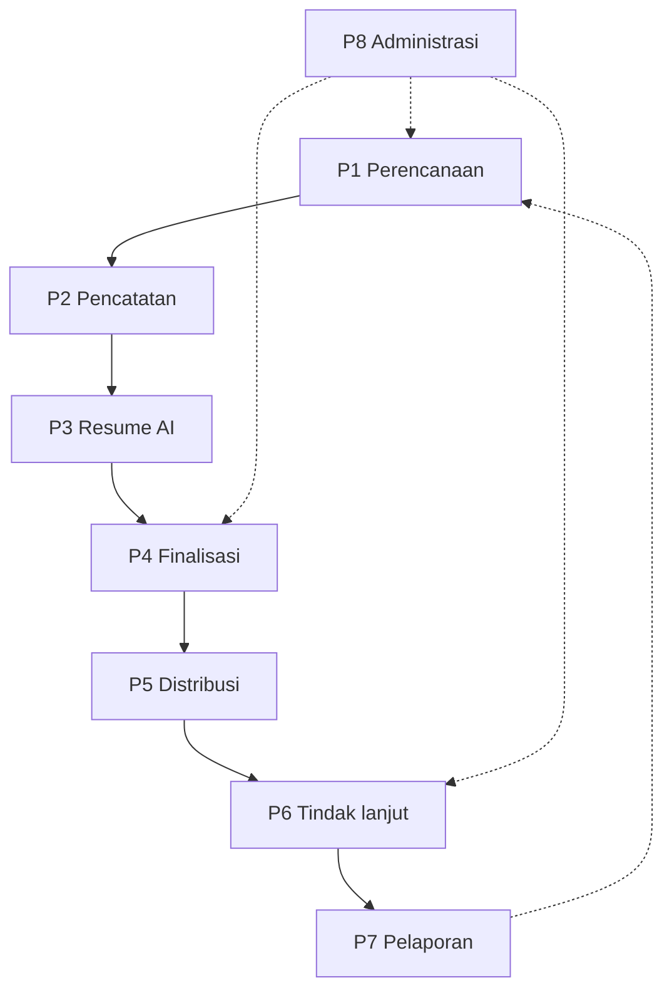

| Kode | Proses | Pemilik proses | Output |
| --- | --- | --- | --- |
| P1 | Perencanaan & pembuatan notulen | Notulis | Draf notulen, peserta, agenda |
| P2 | Pencatatan rapat | Notulis | Isi notulen, tag, keputusan, tugas |
| P3 | Resume AI & verifikasi | Notulis + AI | Resume dan usulan tugas terverifikasi |
| P4 | Finalisasi | Notulis | Notulen final dan terkunci |
| P5 | Distribusi & notifikasi | Sistem | Notifikasi dan halaman terkait |
| P6 | Tindak lanjut action item | PIC + Sistem | Status tugas dan pengingat |
| P7 | Pelaporan & rekap | Manajer + AI | Rekap mingguan/bulanan |
| P8 | Administrasi, akses & audit | Admin | Pengguna, topik, divisi, jejak audit |

## 4. Proses End-to-End

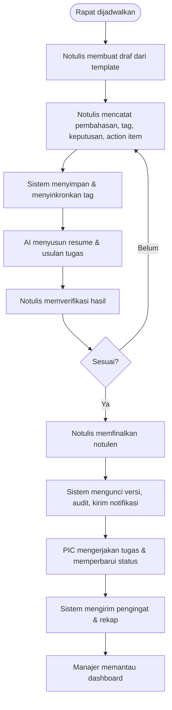

## 5. Proses P1 — Perencanaan & Pembuatan Notulen

### 5.1 Alur

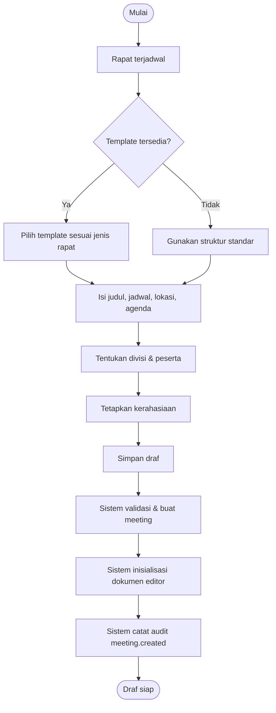

### 5.2 Aturan

- Notulen baru selalu `draft`.
- Template default memuat agenda, pembahasan, keputusan, dan action item.
- Peserta internal diambil dari direktori; tamu eksternal hanya nama/email.
- Kerahasiaan default `division`; admin dapat mengubah.
- Agenda dan peserta dapat diimpor dari kalender pada Fase 2.

### 5.3 Output

Draf notulen dengan peserta, agenda, dan struktur dokumen siap diisi.

## 6. Proses P2 — Pencatatan Rapat

### 6.1 Alur

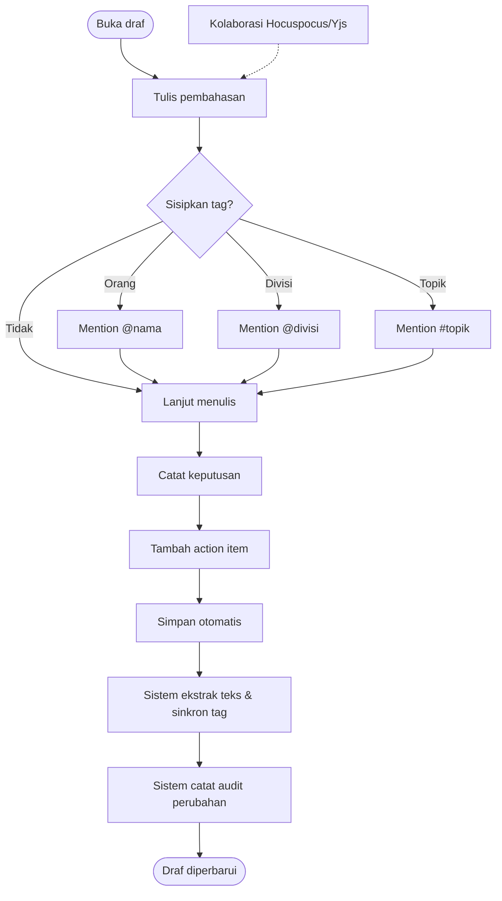

### 6.2 Aturan Tagging

| Tag | Perilaku |
| --- | --- |
| `@orang` | Menyimpan ID pengguna, label, dan posisi; muncul di "Terkait Saya" |
| `@divisi` | Mencakup seluruh anggota divisi untuk notifikasi; akses tetap mengikuti kerahasiaan |
| `#topik` | Menghubungkan notulen ke halaman topik; topik harus terdaftar |
| Duplikat | Digabung per `(type, target_id)` dalam satu notulen |

### 6.3 Aturan Action Item

- Judul wajib; PIC dan tenggat wajib sebelum finalisasi.
- Status awal `new`; PIC/notulis/admin dapat mengubah status.
- `done` mengisi `completed_at`; reopen menghapusnya.
- `overdue` dihitung dari tenggat dan status, bukan disimpan.

### 6.4 Output

Dokumen notulen lengkap dengan tag, keputusan, dan action item.

## 7. Proses P3 — Resume AI & Verifikasi

### 7.1 Alur

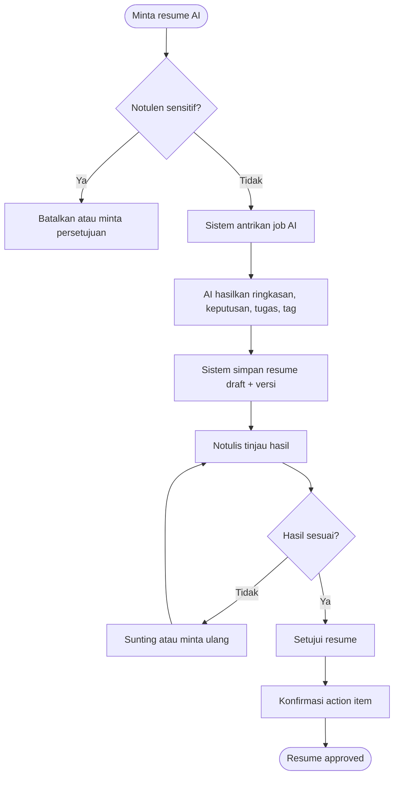

### 7.2 Guardrail

- AI hanya menerima notulen yang boleh diakses peminta.
- Hasil selalu `draft` sampai disetujui.
- Notulen `secret` dikecualikan kecuali disetujui eksplisit.
- Setiap hasil menyimpan model, versi, waktu, dan sumber.
- Kegagalan AI tidak menghalangi penyuntingan manual atau finalisasi.

### 7.3 Output

Resume terverifikasi, usulan action item terkonfirmasi, dan saran tag yang dapat diterima/ditolak.

## 8. Proses P4 — Finalisasi

### 8.1 Alur

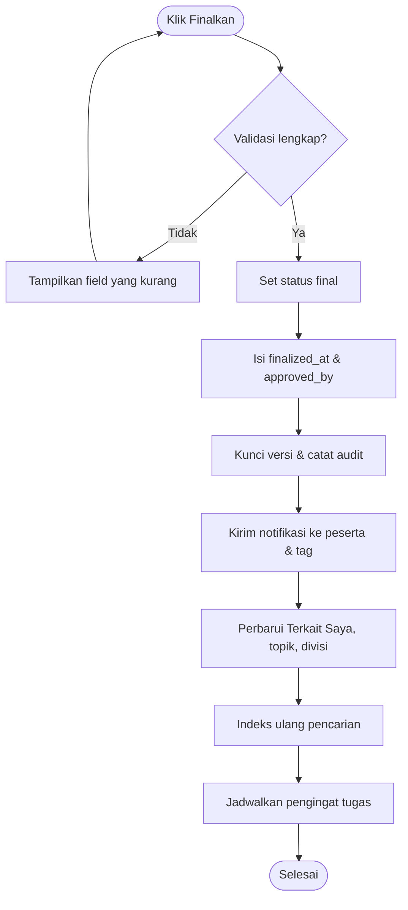

### 8.2 Validasi Finalisasi

| Validasi | Aksi bila gagal |
| --- | --- |
| Judul terisi | Tampilkan error |
| Action item memiliki PIC | Tampilkan error |
| Action item memiliki tenggat | Tampilkan error |
| Kerahasiaan valid | Tampilkan error |
| Status masih draf | Tolak finalisasi ganda |
| Pengguna berhak | Tolak dengan 403 |

### 8.3 Setelah Final

- Notulen berstatus `final`; hanya admin yang dapat menyunting.
- Versi terkunci; perubahan admin tetap tercatat di audit.
- Notifikasi distribusi dikirim.
- Notulen muncul di halaman terkait, topik, divisi, dan hasil pencarian.

## 9. Proses P5 — Distribusi & Notifikasi

### 9.1 Alur

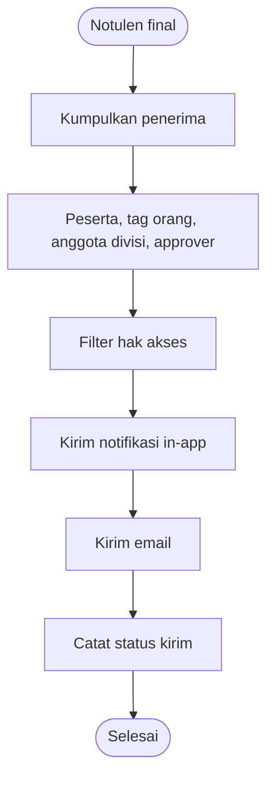

### 9.2 Matriks Notifikasi

| Event | Penerima | Kanal | Waktu | Syarat |
| --- | --- | --- | --- | --- |
| Tag pada draf | Kolaborator/notulis | In-app | Segera | Opsional, untuk kolaborasi |
| Notulen difinalkan | Peserta, tag orang, anggota divisi tag | In-app + email | Setelah final | Penerima berhak melihat |
| Tugas diberikan | PIC | In-app + email | Setelah final | PIC terisi |
| Resume AI selesai | Notulis | In-app | Setelah job | Status draft |
| Pengingat H-3 | PIC | Email/in-app | 09.00 | Tugas belum selesai |
| Pengingat H-1 | PIC | Email/in-app | 09.00 | Tugas belum selesai |
| Terlambat | PIC + kepala divisi | Email/in-app | Harian | Melewati tenggat |
| Rekap mingguan | Pengguna + kepala divisi | Email | Senin 08.00 | Ada aktivitas |
| AI gagal | Notulis + admin | In-app | Setelah retry gagal | Job gagal |

### 9.3 Aturan

- Penerima yang tidak berhak tidak boleh menerima ringkasan atau tautan notulen.
- Notifikasi email memuat tautan aman dan label kerahasiaan.
- Preferensi pengguna dapat menonaktifkan email non-kritis.
- Pengiriman gagal dicatat dan di-retry.

## 10. Proses P6 — Tindak Lanjut Action Item

### 10.1 Alur

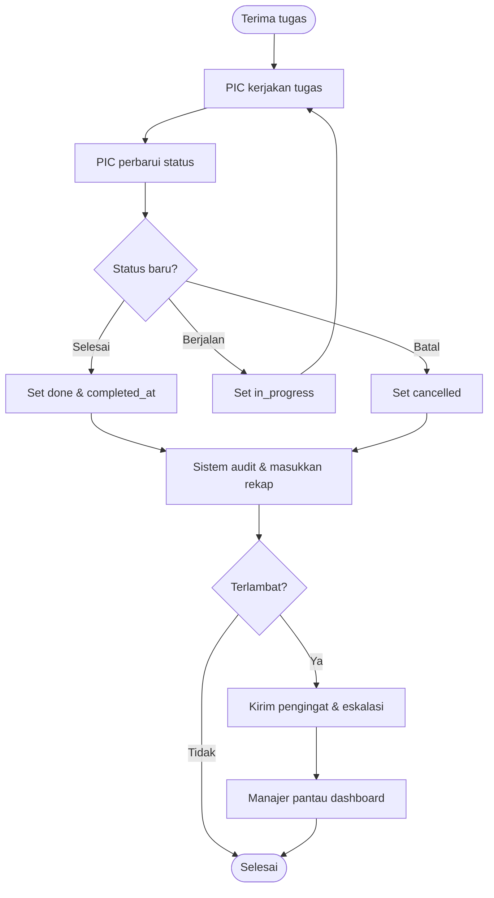

### 10.2 Aturan

- Hanya PIC, notulis, atau admin yang dapat mengubah status.
- Tugas `cancelled` tidak dihitung terlambat.
- Tugas selesai menyimpan `completed_at`.
- Tugas terlambat muncul di dashboard dan rekap.
- Tugas yang belum selesai dibahas pada rapat berikutnya.

## 11. Proses P7 — Pelaporan & Rekap

### 11.1 Alur

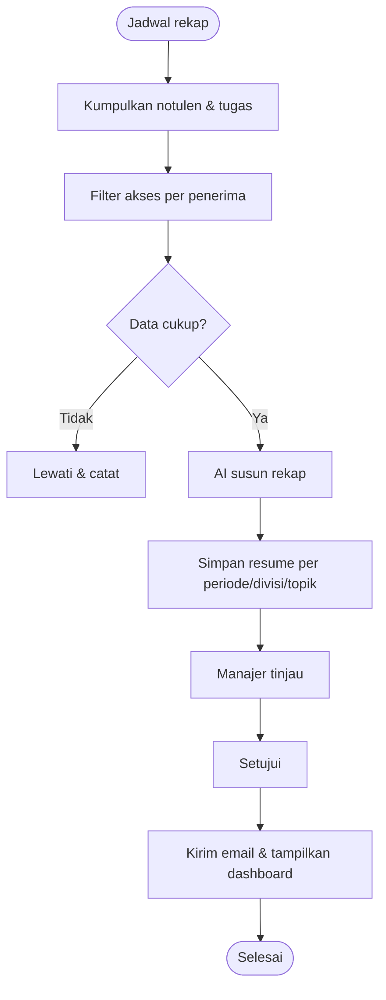

### 11.2 Aturan

- Rekap tidak memuat notulen yang tidak boleh diakses penerima.
- Rekap AI berlabel "dibuat AI" dan menautkan sumber.
- Rekap dapat diekspor PDF/Word.
- Rekap mingguan dan bulanan memiliki periode yang jelas.

## 12. Proses P8 — Administrasi, Akses & Audit

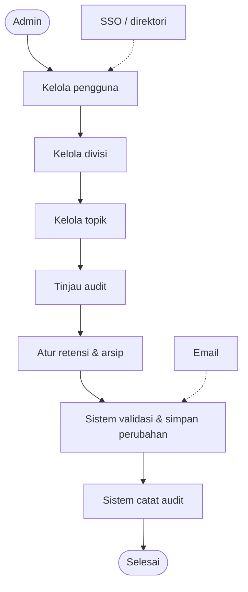

## 13. State Machine

### 13.1 Notulen

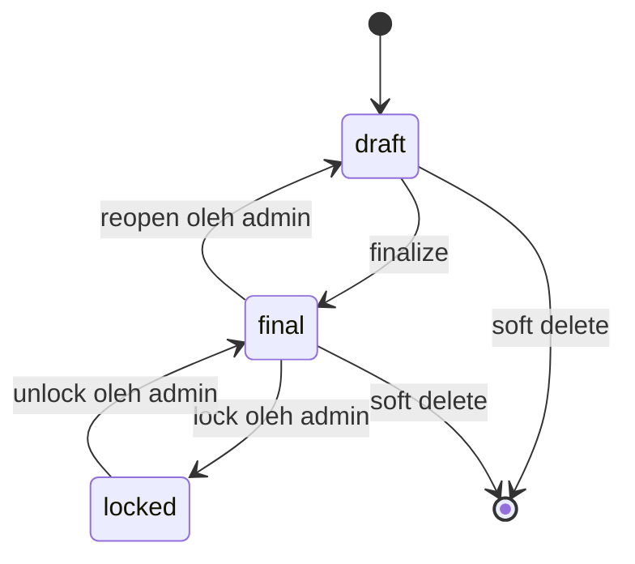

Catatan: transisi `locked` dan `reopen` sudah tersedia di model enum, tetapi alur UI-nya masuk fase penyempurnaan. Saat ini finalisasi mengubah `draft` → `final`; penyuntingan setelah final hanya untuk admin.

### 13.2 Action Item

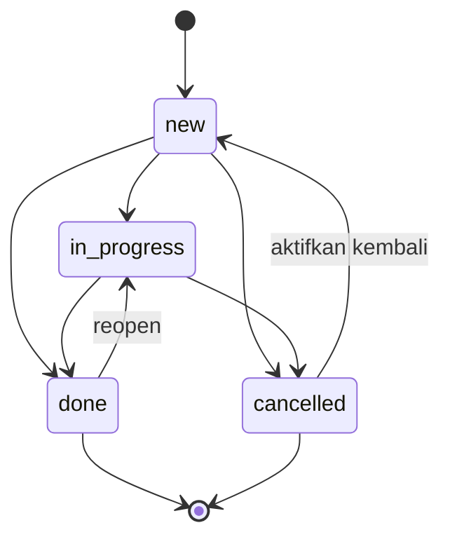

`overdue` bukan state tersimpan; nilainya dihitung dari `due_date` dan status.

### 13.3 Resume AI

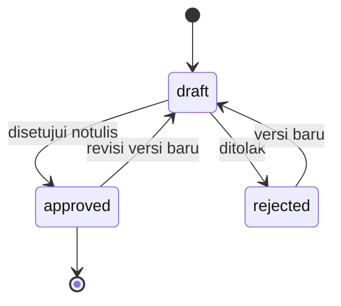

## 14. Pengecualian & Penanganan

| Kode | Pengecualian | Deteksi | Penanganan | Dampak pengguna |
| --- | --- | --- | --- | --- |
| EX-01 | Layanan AI gagal/timeout | Job error | Retry, fallback manual, notifikasi admin | Notulen tetap dapat difinalkan tanpa AI |
| EX-02 | AI menghasilkan data sensitif | Filter konten | Tolak hasil, catat audit | Resume tidak disimpan |
| EX-03 | Hocuspocus tidak tersedia | Health check | Mode penyuntingan tunggal + peringatan | Kolaborasi sementara nonaktif |
| EX-04 | Tag duplikat | Sinkronisasi tag | Gabung per tipe/target | Tidak ada duplikasi |
| EX-05 | Topik tidak ditemukan | Validasi mention | Sarankan topik terdekat atau buat baru | Mention gagal disimpan |
| EX-06 | Finalisasi tanpa PIC/tenggat | Validasi | Tampilkan daftar tugas kurang | Finalisasi ditolak |
| EX-07 | Penerima notifikasi tidak berhak | Filter akses | Lewati penerima, catat | Tidak ada kebocoran |
| EX-08 | Email gagal | Bounce/error | Retry, fallback in-app | Notifikasi tertunda |
| EX-09 | Peserta eksternal | Input manual | Simpan nama/email tanpa akun | Tidak dapat login |
| EX-10 | Notulen rahasia diminta AI | Cek kerahasiaan | Tolak kecuali persetujuan eksplisit | AI tidak dipakai |
| EX-11 | Pengguna dihapus | FK set null/cascade | Notulen tetap ada; PIC menjadi kosong | Perlu penetapan PIC ulang |
| EX-12 | Lampiran gagal upload | Error storage | Retry, tampilkan error | Notulen tetap tersimpan |

## 15. RACI Proses

| Aktivitas | Notulis | Peserta/PIC | Kepala Divisi | Admin | Manajer IT | AI |
| --- | --- | --- | --- | --- | --- | --- |
| Perencanaan notulen | R/A | C | I | I | I | – |
| Pencatatan & tagging | R/A | C | I | I | I | – |
| Resume & verifikasi | R/A | I | I | I | I | R |
| Finalisasi | R/A | I | I | C | I | – |
| Distribusi | C | I | I | R | I | – |
| Tindak lanjut | C | R/A | C | I | I | – |
| Pelaporan | C | I | R | I | A | R |
| Administrasi & audit | I | I | I | R/A | A | – |

## 16. SLA & Indikator Proses

| Proses | Indikator | Target |
| --- | --- | --- |
| P1 Perencanaan | Waktu membuat draf dari template | ≤ 5 menit |
| P2 Pencatatan | Autosave | ≤ 2 detik |
| P2 Pencatatan | Tag tersinkron setelah simpan | ≤ 2 detik |
| P3 AI | Resume selesai untuk notulen standar | ≤ 60 detik |
| P4 Finalisasi | Validasi + kunci versi | ≤ 3 detik |
| P5 Distribusi | Notifikasi terkirim setelah final | ≤ 24 jam (target: segera) |
| P6 Tindak lanjut | Pengingat H-3/H-1 terkirim | 09.00 zona waktu kantor |
| P7 Pelaporan | Rekap mingguan tersedia | Senin 08.00 |
| Pencarian | Hasil muncul | ≤ 3 detik |
| Audit | Aksi tercatat | ≤ 1 detik setelah aksi |

## 17. Status Implementasi Proses

| Proses | Status | Catatan |
| --- | --- | --- |
| P1 Perencanaan | Sebagian | CRUD, template, peserta, kerahasiaan sudah ada; impor kalender belum |
| P2 Pencatatan | Sebagian | Editor, autosave, tag sync, keputusan, action item, lampiran; saran ketik `@` belum |
| P3 Resume AI | Sudah | Adapter OpenAI-compatible/mock, job, verifikasi, dan penerapan action item |
| P4 Finalisasi | Sudah | Validasi PIC/tenggat, status final, audit, kunci versi, lock/unlock |
| P5 Distribusi | Sudah | Notifikasi in-app dan email, filter penerima, preferensi |
| P6 Tindak lanjut | Sudah | Status, overdue, board, dan pengingat H-3/H-1 |
| P7 Pelaporan | Sebagian | Dashboard dasar; rekap AI dan ekspor belum |
| P8 Administrasi | Sebagian | Pengguna, divisi, topik, template, audit; SSO dan retensi belum |

## 18. Referensi

- `01-PRD-Sistem-Notulensi.md` — kebutuhan, aturan bisnis, akses.
- `02-ERD-Sistem-Notulensi.md` — entitas dan relasi.
- `04-Matriks-Traceability.md` — keterkaitan kebutuhan, proses, dan status.
