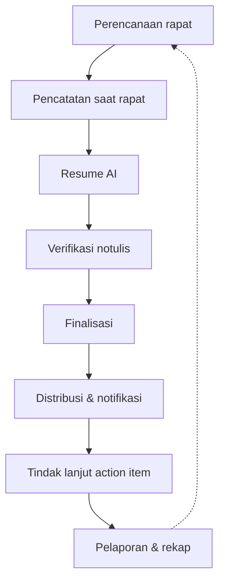
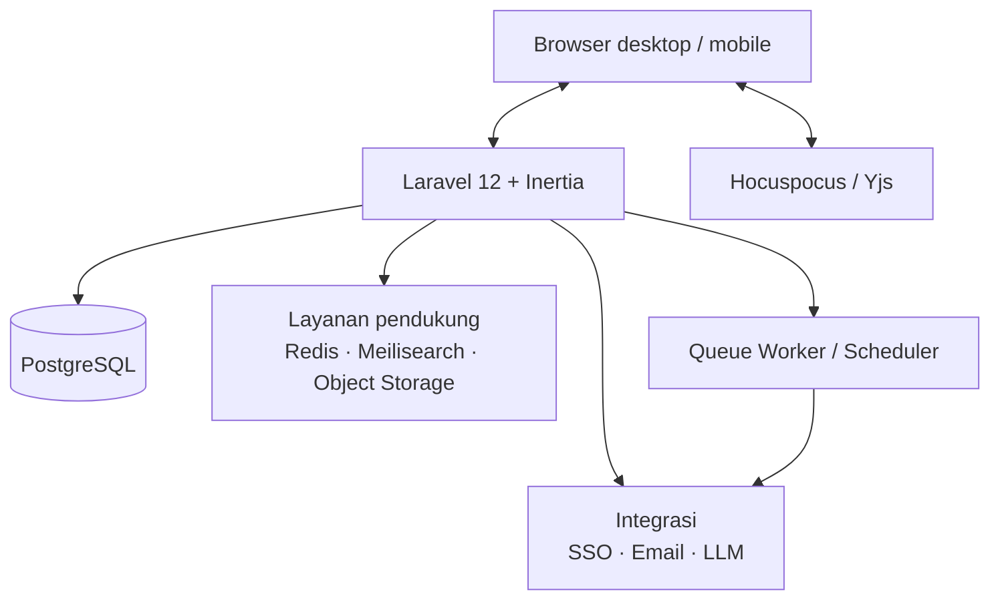
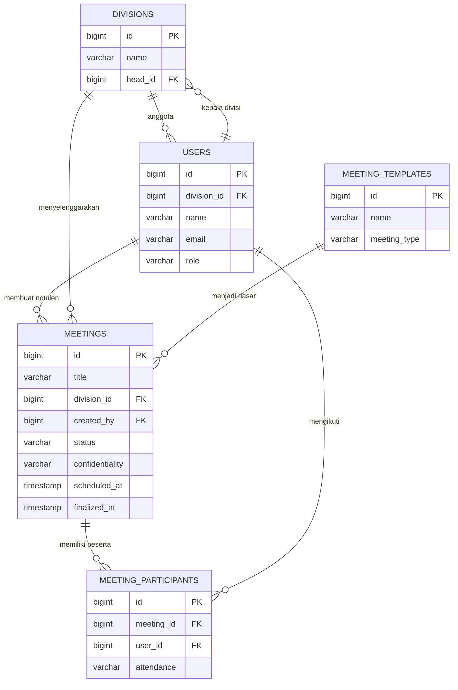
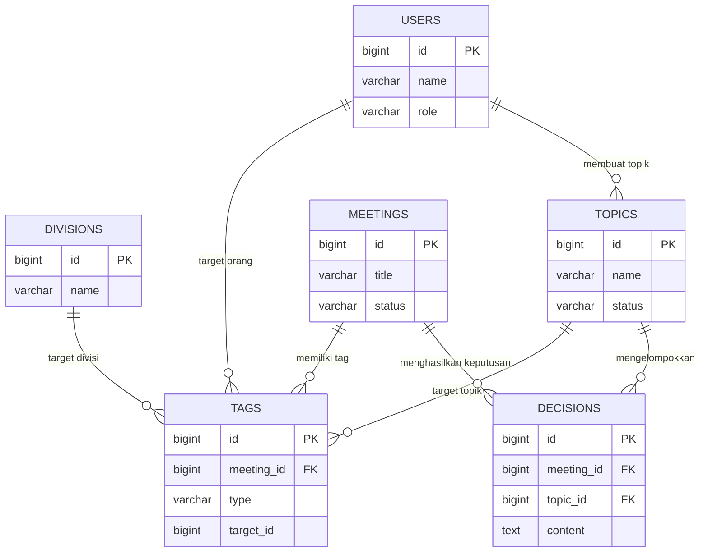
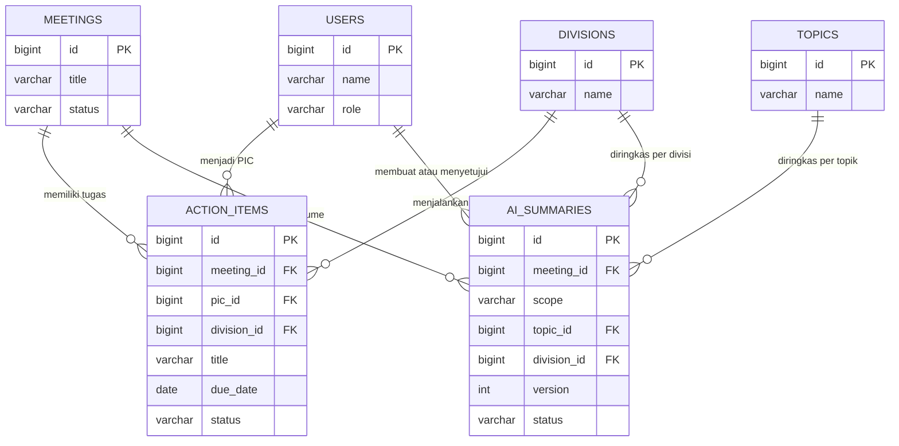
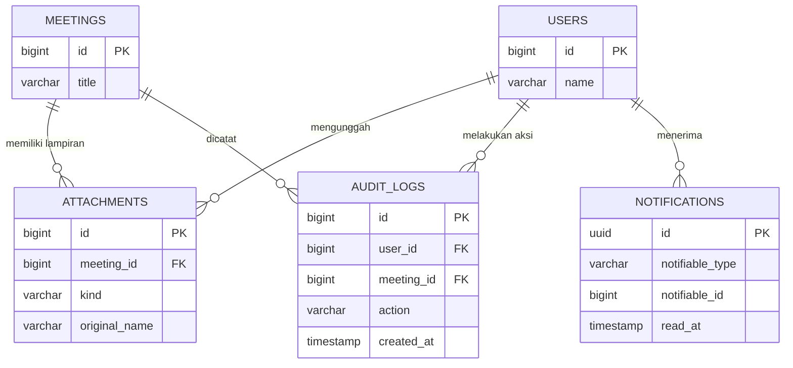

# Paket Presentasi Klien - Sistem Notulensi (MoM) Terintegrasi AI

**Kode dokumen:** DOC-PKG-MOM-001  
**Versi:** 1.0  
**Tanggal:** 9 November 2026  
**Status:** Draft untuk persetujuan klien  
**Pemilik:** Wafiq Lana Pradana  
**Audiens:** Manajemen, Product Owner, Kepala Divisi, IT, QA, Vendor

> Paket ini menggabungkan Blueprint Sistem (05), Product Requirements Document (01), dan ERD & Kamus Data (02). Bisnis Proses (03) dan Matriks Traceability (04) tersedia sebagai dokumen pendukung terpisah. Setiap bagian mempertahankan penomoran aslinya. Aspek komersial dan pembiayaan tidak dibahas dalam dokumen ini.

## Isi Paket

| Bagian | Dokumen | Fokus |
|---|---|---|
| I | Blueprint Sistem Notulensi | Modul, fitur, peran, proses, arsitektur, dan rilis |
| II | PRD Sistem Notulensi | Masalah, tujuan, kebutuhan fungsional, aturan bisnis, akses, dan NFR |
| III | ERD dan Kamus Data | Entitas, relasi, kamus data, indeks, dan siklus hidup |

---
# Blueprint Sistem Notulensi (MoM) Terintegrasi AI

**Kode dokumen:** DOC-BLP-MOM-001  
**Versi:** 1.0  
**Tanggal:** 9 November 2026  
**Status:** Draft untuk persetujuan klien  
**Pemilik:** Wafiq Lana Pradana  
**Audiens:** Manajemen, Product Owner, Kepala Divisi, IT, QA

> Dokumen ini adalah ringkasan presentasi untuk klien. Isi teknis mendalam tetap mengacu pada PRD (01), ERD (02), Bisnis Proses (03), dan Matriks Traceability (04). Aspek komersial dan pembiayaan tidak dibahas dalam dokumen ini.

## 1. Ringkasan Eksekutif

Sistem Notulensi (MoM) adalah aplikasi web internal untuk mencatat, merangkum, mendistribusikan, dan menindaklanjuti hasil rapat lintas divisi.

Nilai utama sistem:

- Satu sumber kebenaran untuk notulen, keputusan, dan action item.
- Resume AI mempercepat pembacaan; manusia tetap memverifikasi sebelum notulen difinalkan.
- Tagging `@orang`, `@divisi`, dan `#topik` membuat distribusi, pencarian, dan halaman terkait berjalan otomatis.
- Action item memiliki PIC dan tenggat yang jelas, dengan pengingat dan pelacakan status.
- Hak akses berlapis, audit trail, dan label kerahasiaan menjaga informasi sensitif.

Inti penawaran untuk fase pertama adalah alur lengkap dari rapat sampai tindak lanjut: buat notulen, catat keputusan dan tugas, minta resume AI, verifikasi, finalkan, distribusikan, lalu pantau penyelesaian tugas.

## 2. Masalah Utama dan Solusi

| Masalah | Dampak | Solusi dalam sistem |
|---|---|---|
| Notulen tersebar di chat, email, dan dokumen pribadi | Sulit dicari dan rawan hilang | Pusat notulen, pencarian teks penuh, dan filter |
| PIC dan tenggat tidak jelas | Tindak lanjut rapat terlewat | Tabel action item wajib PIC dan tenggat sebelum final |
| Keputusan divisi lain tidak diketahui | Silo informasi dan pekerjaan duplikatif | Tagging divisi/topik dan halaman lintas divisi |
| Notulen panjang dan tidak seragam | Manajemen sulit membaca ringkasan | Template standar dan resume AI |
| Jejak akses dan perubahan tidak ada | Sulit diaudit dan dipertanggungjawabkan | Audit log, version history, dan label kerahasiaan |

## 3. Tujuan dan Metrik Keberhasilan

| Tujuan | Metrik | Target 6 bulan |
|---|---|---|
| Notulen tersentralisasi | Rapat resmi tercatat di sistem | >= 90% |
| Distribusi cepat | Waktu kirim setelah finalisasi | <= 24 jam, target segera |
| Tindak lanjut jelas | Action item memiliki PIC dan tenggat | 100% |
| Penyelesaian tepat waktu | Action item selesai sesuai tenggat | >= 80% |
| Efisiensi membaca | Notulen dengan resume AI yang dipakai | >= 70% |
| Kualitas AI | Resume disetujui tanpa koreksi besar | >= 80% |
| Kinerja | Waktu muat halaman dan pencarian | <= 2 detik dan <= 3 detik |

## 4. Peta Sistem

Alur utama:

```text
Perencanaan -> Pencatatan -> Resume AI -> Verifikasi -> Finalisasi
     -> Distribusi -> Tindak Lanjut -> Pelaporan dan Rekap
```

Arsitektur ringkas:

```text
+-------------------------------------+
| Browser Desktop / Mobile            |
| Vue 3 + Inertia + Tiptap Editor     |
+----------------+--------------------+
                 | HTTPS
+----------------v--------------------+      +------------------------+
| Laravel 13                          |<---->| Layanan AI (LLM API)   |
| Auth - Policy - Notulen - Tagging   |      | Resume - Ekstraksi     |
| Action Item - AI - Notifikasi       |      +------------------------+
+---+-------------+-------------+-----+
    |             |             |
+---v----+   +----v-----+   +---v--------------+
|Postgres|   |Queue dan |   |Object Storage    |
|        |   |Scheduler |   |Lampiran          |
+--------+   +----+-----+   +------------------+
                  |
             +----v-----+
             |Email/SMTP|
             +----------+

+-------------------------------------+
| Hocuspocus / Yjs                    |
| Kolaborasi real-time dan presence   |
+-------------------------------------+
```

## 5. Matriks Modul

| No | Modul | Fungsi Utama | Aktor | Rilis |
|---|---|---|---|---|
| 1 | Autentikasi dan Profil | Login, logout, reset password, 2FA, profil | Semua pengguna | R1 |
| 2 | Dashboard | Statistik, rapat mendatang, tugas saya, overdue | Semua pengguna | R1 |
| 3 | Notulen dan Editor | Buat, sunting, template, peserta, kerahasiaan, lampiran | Notulis, Admin | R1 |
| 4 | Tagging dan Pengetahuan | Mention orang/divisi/topik, halaman terkait | Notulis, pembaca | R1 |
| 5 | Pencarian dan Filter | Teks penuh, tanggal, divisi, topik, status | Semua pengguna | R1 |
| 6 | Action Item | Tabel, board, PIC, tenggat, status, overdue | PIC, Notulis, Admin | R1 |
| 7 | AI Assistant | Resume, keputusan, usulan tugas, saran tag | Notulis, Admin | R1 |
| 8 | Notifikasi dan Distribusi | In-app, email, pengingat | Semua penerima | R1 |
| 9 | Administrasi dan Audit | Pengguna, divisi, topik, template, audit | Admin | R1 |
| 10 | Kolaborasi Real-time | Dua notulis, presence, fallback | Notulis | R1 |
| 11 | Laporan dan Rekap | Rekap periodik, ekspor | Manajer, Admin | R2 dan R3 |
| 12 | Integrasi Perusahaan | SSO, kalender, chat, transkripsi | Admin, Manajer | R3 |

Keterangan rilis:

- **R1:** MVP dan inti P1, siap pilot 2-3 divisi.
- **R2:** penyempurnaan distribusi, pelaporan, dan ekspor.
- **R3:** integrasi lanjutan dan AI tingkat lanjut.

## 6. Matriks Fitur per Rilis

| ID | Fitur | Prioritas PRD | Rilis |
|---|---|---|---|
| F-01 | Editor dokumen kaya: heading, tabel, daftar, tautan, gambar | P0 | R1 |
| F-02 | Template notulen standar | P0 | R1 |
| F-03 | Template per jenis rapat | P1 | R1 |
| F-04 | Kolaborasi real-time dan riwayat versi | P0 | R1 |
| F-05 | Tabel action item | P0 | R1 |
| F-06 | Draf, final, dan locked | P0 | R1 |
| F-07 | Lampiran file dan tautan | P1 | R1 |
| F-08 | Ekspor PDF dan Word | P1 | R2 |
| F-10 | Tag orang `@nama` | P0 | R1 |
| F-11 | Tag divisi `@divisi` | P0 | R1 |
| F-12 | Tag topik `#topik` | P0 | R1 |
| F-13 | Tag pada level bagian dokumen | P1 | R2 |
| F-14 | Notifikasi dan halaman terkait | P0 | R1 |
| F-15 | Banyak tag sekaligus | P0 | R1 |
| F-16 | Tamu eksternal | P2 | R2 |
| F-20 | Halaman Terkait Saya | P0 | R1 |
| F-21 | Halaman topik | P0 | R1 |
| F-22 | Halaman divisi dan orang | P1 | R1 |
| F-23 | Pencarian teks penuh dan filter | P0 | R1 |
| F-24 | Board action item | P1 | R1 |
| F-25 | Dashboard ringkasan | P2 | R1 |
| F-30 | Notifikasi email dan in-app | P0 | R1 |
| F-31 | Pengingat H-3, H-1, dan terlambat | P1 | R1 |
| F-32 | Integrasi chat perusahaan | P2 | R3 |
| F-33 | Integrasi kalender | P1 | R3 |
| F-34 | Rekap mingguan otomatis | P1 | R3 |
| F-40 | Resume AI per notulen | P0 | R1 |
| F-41 | Ekstraksi action item | P0 | R1 |
| F-42 | Saran tag | P1 | R1 |
| F-43 | Resume lintas notulen | P1 | R3 |
| F-44 | Tanya-jawab atas notulen | P1 | R3 |
| F-45 | Resume per peran | P2 | R3 |
| F-46 | Transkripsi rekaman | P2 | R3 |
| F-47 | Penerjemahan resume | P2 | R3 |
| F-50 | Manajemen pengguna, divisi, dan peran | P0 | R1 |
| F-50 | SSO perusahaan | P0 | R3 |
| F-51 | Manajemen topik | P1 | R1 |
| F-52 | Audit log | P1 | R1 |
| F-53 | Retensi dan arsip | P2 | R3 |

Catatan: SSO ditempatkan di R3 karena bergantung pada kesiapan Identity Provider perusahaan. R1 memakai login lokal dan 2FA.

## 7. Matriks Peran dan Kerahasiaan

### 7.1 Hak Akses per Peran

| Fungsi | Admin | Notulis | Kepala Divisi | Peserta | Pembaca |
|---|---|---|---|---|---|
| Dashboard | Ya | Ya | Ya | Ya | Ya |
| Buat dan sunting draf | Ya | Ya | Tidak | Tidak | Tidak |
| Finalkan notulen | Ya | Ya | Tidak | Tidak | Tidak |
| Sunting setelah final | Ya | Tidak | Tidak | Tidak | Tidak |
| Lihat sesuai kerahasiaan | Ya | Ya | Ya | Ya | Ya |
| Update status tugas | Ya | Ya | Jika PIC | Jika PIC | Tidak |
| Kelola topik, divisi, pengguna | Ya | Tidak | Tidak | Tidak | Tidak |
| Audit log | Ya | Tidak | Tidak | Tidak | Tidak |
| Resume AI | Ya | Ya | Lihat | Lihat | Lihat |
| Unduh lampiran | Ya | Ya | Sesuai akses | Sesuai akses | Sesuai akses |

### 7.2 Tingkat Kerahasiaan

| Tingkat | Siapa yang dapat melihat | AI |
|---|---|---|
| Terbuka | Semua pengguna terautentikasi | Boleh, dengan label AI |
| Divisi | Peserta dan anggota divisi yang di-tag | Boleh untuk pengguna berhak |
| Terbatas | Peserta dan orang yang di-tag | Hanya jika penanya berhak |
| Rahasia | Peserta tertentu, pembuat, dan admin | Dikecualikan kecuali disetujui eksplisit |

## 8. Matriks Proses Bisnis

| Kode | Proses | Aktor Utama | Output | Modul | SLA |
|---|---|---|---|---|---|
| P1 | Perencanaan dan pembuatan notulen | Notulis | Draf, peserta, agenda | Notulen | <= 5 menit |
| P2 | Pencatatan rapat | Notulis | Isi notulen, tag, keputusan, tugas | Editor dan Tagging | Autosave <= 2 detik |
| P3 | Resume AI dan verifikasi | Notulis dan AI | Resume dan usulan tugas | AI | <= 60 detik |
| P4 | Finalisasi | Notulis | Notulen final dan versi terkunci | Notulen | <= 3 detik |
| P5 | Distribusi dan notifikasi | Sistem | Notifikasi in-app dan email | Notifikasi | <= 24 jam, target segera |
| P6 | Tindak lanjut | PIC dan Sistem | Status tugas dan pengingat | Action Item | Pengingat pukul 09.00 |
| P7 | Pelaporan dan rekap | Manajer dan AI | Rekap mingguan atau bulanan | Laporan | Senin pukul 08.00 |
| P8 | Administrasi dan audit | Admin | Pengguna, topik, divisi, audit | Admin | Audit <= 1 detik |

## 9. Blueprint Data

| Entitas | Fungsi | Relasi Kunci |
|---|---|---|
| `users` | Pengguna, peran, divisi, status aktif | Divisi 1 ke N Pengguna |
| `divisions` | Struktur divisi dan kepala divisi | Divisi 1 ke N Notulen |
| `topics` | Taksonomi topik lintas divisi | Topik 1 ke N Keputusan |
| `meeting_templates` | Template notulen per jenis rapat | Template 1 ke N Notulen |
| `meetings` | Notulen, isi dokumen, status, kerahasiaan | Pembuat 1 ke N Notulen |
| `meeting_participants` | Peserta internal/eksternal dan kehadiran | Notulen N ke N Pengguna |
| `tags` | Mention orang, divisi, dan topik | Notulen 1 ke N Tag |
| `decisions` | Keputusan rapat | Notulen 1 ke N Keputusan |
| `action_items` | Tugas, PIC, tenggat, dan status | Notulen 1 ke N Tugas |
| `ai_summaries` | Resume dan rekap AI | Notulen 1 ke N Resume |
| `attachments` | Berkas, tautan, dan rekaman | Notulen 1 ke N Lampiran |
| `audit_logs` | Jejak akses dan perubahan | Pengguna 1 ke N Audit |
| `notifications` | Notifikasi in-app per pengguna | Pengguna 1 ke N Notifikasi |
| `meeting_versions` | Riwayat versi dokumen | Notulen 1 ke N Versi |
| `collab_documents` | State kolaborasi Yjs | Notulen 1 ke 1 Dokumen kolaborasi |

## 10. Blueprint Arsitektur dan Teknologi

| Lapisan | Teknologi | Fungsi |
|---|---|---|
| Backend | Laravel 13 dan PHP 8.4 | Auth, policy, notulen, queue, scheduler |
| Frontend | Vue 3.5, TypeScript, Inertia 3 | Antarmuka SPA tanpa API terpisah |
| Build | Vite 8 | Kompilasi asset |
| UI | Tailwind 4 dan shadcn-vue | Komponen konsisten dan aksesibel |
| Editor | Tiptap 3 | Teks kaya, tabel, mention, lampiran |
| Kolaborasi | Yjs dan Hocuspocus 4 | Sinkronisasi real-time dan presence |
| Database | PostgreSQL 18 | JSONB, full-text search, trigram |
| Queue | Laravel Queue | AI, email, dan notifikasi asinkron |
| Scheduler | Laravel Scheduler | Pengingat dan rekap |
| AI | Provider-agnostik (OpenAI-compatible) | Resume, ekstraksi, dan saran tag |
| Email | SMTP | Distribusi dan pengingat |
| Storage | Local atau S3-compatible | Lampiran dan rekaman |
| Search | PostgreSQL FTS dan pg_trgm | Pencarian cepat tanpa layanan tambahan |

Pilihan ini menjaga sistem tetap sederhana untuk pilot, tetapi siap ditingkatkan ke Redis, Meilisearch, dan pgvector saat volume data bertambah.

## 11. Blueprint Halaman

| Halaman | Fungsi | Pengguna Utama |
|---|---|---|
| Login dan Reset Password | Autentikasi | Semua |
| Dashboard | Ringkasan aktivitas dan tugas | Semua |
| Daftar Notulen | Cari, filter, dan buka notulen | Semua |
| Buat Notulen | Pilih template dan isi awal | Notulis, Admin |
| Editor Notulen | Menulis, tag, action item, lampiran | Notulis, Admin |
| Detail Notulen | Baca, resume AI, keputusan, tugas | Semua sesuai akses |
| Terkait Saya | Notulen dan tugas yang menyebut saya | Semua |
| Halaman Topik | Notulen, keputusan, tugas per topik | Semua |
| Halaman Divisi | Aktivitas dan notulen divisi | Semua sesuai akses |
| Halaman Orang | Notulen dan tugas per orang | Semua sesuai akses |
| Tugas dan Board | Daftar dan kanban action item | PIC, Notulis, Admin |
| Notifikasi | Riwayat notifikasi | Semua |
| Admin Pengguna | Kelola akun, peran, dan divisi | Admin |
| Admin Divisi | Kelola struktur divisi | Admin |
| Admin Topik | Buat, gabung, dan arsipkan topik | Admin |
| Admin Template | Kelola template notulen | Admin |
| Admin Audit | Jejak akses dan perubahan | Admin |
| Pengaturan | Profil, keamanan, dan preferensi email | Semua |

## 12. Blueprint AI

### 12.1 Keluaran AI

| Keluaran | Isi | Tindakan Manusia |
|---|---|---|
| Resume notulen | Ringkasan, poin penting, keputusan | Notulis menyetujui atau menyunting |
| Ekstraksi action item | Tugas, PIC, tenggat | Notulis mengonfirmasi sebelum disimpan |
| Saran tag | Orang, divisi, topik | Notulis menerima atau menolak |
| Rekap lintas notulen | Per topik, divisi, atau periode | Manajer meninjau |
| Tanya-jawab | Jawaban dengan sitasi sumber | Pengguna membaca sumber |

### 12.2 Guardrail

| Guardrail | Implementasi |
|---|---|
| Manusia memverifikasi | Hasil AI berstatus draft sampai disetujui |
| Hak akses dihormati | AI hanya membaca notulen yang boleh diakses penanya |
| Transparan | Label "dibuat AI" dan tautan sumber |
| Data tidak untuk pelatihan | Penyedia AI wajib memiliki kebijakan no-training |
| Notulen sensitif | Notulen rahasia dikecualikan kecuali disetujui |
| Kegagalan layanan | Retry, fallback manual, dan notifikasi admin |
| Kuota | Pemantauan token dan kuota per divisi |

## 13. Matriks Notifikasi

| Event | Penerima | Kanal | Waktu | Syarat |
|---|---|---|---|---|
| Notulen difinalkan | Peserta, tag orang, anggota divisi tag | In-app dan email | Setelah final | Penerima berhak melihat |
| Tugas diberikan | PIC | In-app dan email | Setelah final | PIC terisi |
| Resume AI selesai | Notulis | In-app | Setelah job | Status draft |
| Pengingat H-3 | PIC | Email dan in-app | Pukul 09.00 | Tugas belum selesai |
| Pengingat H-1 | PIC | Email dan in-app | Pukul 09.00 | Tugas belum selesai |
| Terlambat | PIC dan kepala divisi | Email dan in-app | Harian | Melewati tenggat |
| Rekap mingguan | Pengguna dan kepala divisi | Email | Senin pukul 08.00 | Ada aktivitas |
| AI gagal | Notulis dan admin | In-app | Setelah retry gagal | Job gagal |

## 14. Kebutuhan Non-Fungsional

| Aspek | Kebutuhan |
|---|---|
| Kinerja | Halaman <= 2 detik; pencarian <= 3 detik; resume AI <= 60 detik |
| Ketersediaan | >= 99,5% pada jam kerja |
| Skalabilitas | Seluruh karyawan dan ribuan notulen per tahun |
| Kegunaan | Responsif desktop dan ponsel; bahasa Indonesia |
| Kolaborasi | Penyuntingan bersama tanpa konflik; riwayat versi |
| Keamanan | Policy di level query, enkripsi, audit, dan backup harian |
| Kepatuhan | Jejak audit dan retensi sesuai kebijakan perusahaan |
| Aksesibilitas | Kontras memadai, navigasi keyboard, dan label form |
| Observabilitas | Log terpusat, monitoring queue, dan alert kegagalan AI |

## 15. Rencana Rilis dan Deliverables

| Fase | Cakupan | Durasi Indikatif | Milestone |
|---|---|---|---|
| Fase 0 - Discovery | Wawancara divisi, contoh notulen, daftar divisi/topik, kebijakan data | 1 minggu | Peta proses disetujui |
| Fase 1 - MVP dan Pilot | Template, tagging, action item, notifikasi, resume AI, kolaborasi, pilot 2-3 divisi | 10 minggu | Go-live pilot |
| Fase 2 - Perluasan | Semua divisi, halaman divisi/orang, pengingat, board, ekspor | 7 minggu | Full rollout |
| Fase 3 - Penyempurnaan | SSO, kalender, chat, Q&A, rekap, transkripsi, evaluasi | 2 minggu | Evaluasi manfaat |

Deliverables:

- Aplikasi web siap pakai di lingkungan staging dan produksi.
- Database, seed demo, dan konfigurasi environment.
- Panduan pengguna dan panduan admin.
- Dokumen teknis dan matriks traceability yang diperbarui.
- Laporan UAT dan berita acara serah terima.
- Pelatihan notulis champion dan admin.

## 16. Kriteria Penerimaan (UAT)

### 16.1 Fungsional

- Login dan hak akses setiap peran berjalan sesuai matriks.
- Notulen dapat dibuat dari template, disunting, dan difinalkan.
- Mention `@orang`, `@divisi`, dan `#topik` tersimpan dan muncul di halaman terkait.
- Action item wajib memiliki PIC dan tenggat sebelum finalisasi.
- Resume AI dapat dibuat, disunting, disetujui, dan diterapkan ke action item.
- Notifikasi in-app dan email terkirim hanya kepada pihak yang berhak.
- Pencarian dan filter menampilkan hasil sesuai akses.
- PIC dapat memperbarui status tugas dan perubahan tercatat di audit.
- Dua notulis dapat menyunting bersamaan; fallback berjalan jika layanan kolaborasi mati.
- Admin dapat mengelola pengguna, divisi, topik, template, dan melihat audit.

### 16.2 KPI

- >= 90% rapat resmi tercatat.
- 100% action item memiliki PIC dan tenggat.
- >= 80% action item selesai tepat waktu.
- >= 70% notulen memiliki resume AI yang dipakai.
- Waktu muat <= 2 detik dan pencarian <= 3 detik.

## 17. Di Luar Lingkup

- Pengganti aplikasi video meeting atau kalender.
- Sistem manajemen proyek penuh.
- Transkripsi audio otomatis pada rilis awal.
- Aplikasi mobile native.
- Pengadaan perangkat, lisensi, dan infrastruktur.
- Migrasi seluruh arsip lama.
- Pembahasan komersial dan pembiayaan.

## 18. Risiko dan Mitigasi

| Risiko | Dampak | Mitigasi |
|---|---|---|
| Notulis tidak disiplin mengisi | Data tidak lengkap | Template sederhana, target kepatuhan, dukungan manajemen |
| Resume AI keliru | Salah informasi | Verifikasi manusia, sitasi, dan label AI |
| Kebocoran data sensitif | Risiko hukum dan reputasi | Klasifikasi, policy, pengecualian AI, dan audit |
| Notifikasi berlebihan | Pengguna mengabaikan | Preferensi, rekap gabungan, dan batching |
| Adopsi rendah | Sistem tidak dipakai | Pilot, pelatihan, dan champion divisi |
| Ketergantungan layanan AI/Node | Fitur terganggu | Fallback, health check, dan runbook |

## 19. Pertanyaan Terbuka untuk Klien

1. Berapa jumlah divisi dan karyawan yang akan menggunakan sistem?
2. Apakah perusahaan memakai Google Workspace, Microsoft 365, atau keduanya?
3. Siapa yang menjadi notulis: sekretaris, anggota bergilir, atau siapa saja?
4. Apakah ada rapat dengan data sensitif yang tidak boleh diproses AI eksternal?
5. Penyedia AI mana yang diizinkan dan di mana data boleh diproses?
6. Saluran notifikasi utama: email, WhatsApp, atau chat perusahaan?
7. Apakah perlu dukungan notulen campuran Indonesia-Inggris?
8. Kebijakan retensi notulen dan rekaman?
9. Siapa admin yang ditunjuk untuk notulen rahasia?
10. Apakah kalender perusahaan menggunakan Google atau Microsoft?

## 20. Persetujuan

| Peran | Nama | Tanda Tangan / Tanggal |
|---|---|---|
| Pemilik Produk | Wafiq Lana Pradana | |
| Perwakilan Divisi | | |
| IT / Pengembang | | |
| Manajemen | | |

## Lampiran A - Glosarium

| Istilah | Arti |
|---|---|
| MoM | Minutes of Meeting atau notulen rapat |
| Notulis | Pengguna yang menulis dan memfinalkan notulen |
| Tag | Penanda orang, divisi, atau topik di dalam notulen |
| Mention | Tag yang disisipkan di editor |
| Action item | Tugas tindak lanjut dari rapat |
| PIC | Person in Charge |
| Resume AI | Ringkasan yang dihasilkan model bahasa |
| R1, R2, R3 | Tahap rilis pertama, kedua, dan ketiga |
| UAT | User Acceptance Test |
| SSO | Single Sign-On |

---

**Catatan dokumen:** Blueprint ini adalah ringkasan untuk presentasi klien. Perubahan requirement wajib memperbarui PRD, ERD, bisnis proses, matriks traceability, dan dokumen ini.


---

# PRD — Sistem Notulensi (MoM) Terintegrasi AI

**Kode dokumen:** DOC-PRD-MOM-001  
**Versi:** 1.0  
**Tanggal:** 26 Oktober 2026  
**Status:** Final draft untuk persetujuan  
**Pemilik produk:** Wafiq Lana Pradana  
**Reviewer:** Manager IT, Kepala Divisi Pilot  
**Approver:** Manajemen

> Dokumen ini adalah acuan produk untuk pembangunan Sistem Notulensi (Minutes of Meeting/MoM). Aspek komersial dan pembiayaan tidak dibahas dalam dokumen ini. Data model dijelaskan pada `02-ERD-Sistem-Notulensi.md`; alur kerja dijelaskan pada `03-Bisnis-Proses-Sistem-Notulensi.md`.

## Riwayat Versi

| Versi | Tanggal | Perubahan | Penyusun |
| --- | --- | --- | --- |
| 0.1 | 26 Okt 2026 | Draf awal kebutuhan produk | Wafiq Lana Pradana |
| 0.2 | 26 Okt 2026 | Penambahan rekomendasi tech stack | Wafiq Lana Pradana |
| 1.0 | 26 Okt 2026 | Konsolidasi PRD, ERD, bisnis proses, dan keputusan arsitektur | Wafiq Lana Pradana |

## 1. Ringkasan Eksekutif

Sistem Notulensi (MoM) adalah aplikasi web internal untuk mencatat, mendistribusikan, dan menindaklanjuti hasil rapat lintas divisi. Setiap notulen dapat menandai peserta, divisi, dan topik melalui `@orang`, `@divisi`, dan `#topik`, sehingga pihak terkait otomatis menerima notifikasi dan dapat menemukan kembali keputusan serta tugasnya.

Pengalaman menulis dibuat mirip Google Docs: teks kaya, tabel, daftar, lampiran, dan kolaborasi. Seluruh notulen terhubung ke layanan AI untuk menghasilkan ringkasan, daftar keputusan, usulan action item, saran tag, serta tanya-jawab lintas notulen. AI tidak pernah menjadi sumber kebenaran tunggal: notulis wajib memverifikasi sebelum notulen difinalkan.

**Keputusan arsitektur:** aplikasi custom (Opsi B) dengan pilot bertahap di 2–3 divisi. Pendekatan ini dipilih karena kebutuhan P0 — tagging lintas dokumen, hak akses granular, halaman "Terkait Saya", pencarian terfilter, dan pelacakan action item — tidak dapat dipenuhi secara konsisten di Google Workspace.

**Hasil yang diharapkan dalam 6 bulan:**

- ≥ 90% rapat resmi tercatat di sistem.
- 100% action item memiliki PIC dan tenggat.
- ≥ 80% action item selesai tepat waktu.
- ≥ 70% notulen memiliki resume AI yang dipakai.
- Seluruh divisi aktif menggunakan sistem.

## 2. Latar Belakang & Masalah

| Masalah | Dampak |
| --- | --- |
| Notulen tersebar di dokumen pribadi, chat, dan email | Sulit dicari kembali, tidak ada sumber tunggal, dan rawan hilang |
| Tidak ada kejelasan PIC dan tenggat action item | Tindak lanjut rapat terlewat |
| Keputusan rapat divisi lain tidak diketahui | Silo informasi dan pekerjaan duplikatif |
| Notulen panjang dan tidak seragam | Manajemen sulit membaca ringkasan cepat |
| Tagging dan pencarian lintas dokumen lemah | Notulen yang relevan tidak ditemukan saat dibutuhkan |
| Jejak akses dan perubahan tidak tercatat | Sulit diaudit dan dipertanggungjawabkan |

## 3. Tujuan & Metrik Keberhasilan

| Tujuan | Metrik | Baseline | Target 6 bulan | Sumber |
| --- | --- | --- | --- | --- |
| Notulen tersentralisasi | % rapat resmi tercatat | Belum diukur | ≥ 90% | Register notulen |
| Distribusi cepat | Waktu kirim ke peserta/tag | Manual | ≤ 24 jam | Log notifikasi |
| Tindak lanjut jelas | % action item punya PIC & tenggat | Belum diukur | 100% | Tabel action item |
| Penyelesaian tindak lanjut | % action item selesai tepat waktu | Belum diukur | ≥ 80% | Status action item |
| Efisiensi membaca | % notulen dengan resume AI yang dipakai | 0% | ≥ 70% | Log akses resume |
| Adopsi | Divisi aktif | 0 | Semua divisi | Pengguna aktif |
| Kualitas AI | % resume disetujui tanpa koreksi besar | Belum ada | ≥ 80% | Riwayat persetujuan |
| Kinerja | Waktu muat & pencarian | Belum diukur | ≤ 2 dtk / ≤ 3 dtk | APM/log server |

## 4. Ruang Lingkup

### 4.1 Termasuk

- Pembuatan dan penyuntingan notulen dari template.
- Tagging orang, divisi, dan topik pada level dokumen dan bagian tertentu.
- Halaman "Terkait Saya", halaman topik, halaman divisi, dan halaman orang.
- Pencarian teks penuh dengan filter tanggal, divisi, topik, orang, dan status.
- Tabel action item, board tindak lanjut, pengingat tenggat, dan rekap.
- Notifikasi email dan in-app.
- Resume AI, ekstraksi action item, saran tag, rekap lintas notulen, dan tanya-jawab sesuai hak akses.
- Administrasi pengguna, divisi, topik, peran, audit, dan retensi.
- Integrasi SSO, kalender, dan kanal chat pada fase lanjutan.

### 4.2 Tidak Termasuk

- Pengganti aplikasi video meeting atau kalender.
- Sistem manajemen proyek penuh; hanya pelacakan action item dari rapat.
- Transkripsi audio otomatis pada rilis awal (fase lanjutan).
- Aplikasi mobile native; antarmuka web responsif sudah mencakup ponsel.
- Pengadaan perangkat, lisensi, dan infrastruktur.
- Migrasi seluruh arsip lama; dilakukan bertahap bila diperlukan.
- Pembahasan komersial, pembiayaan, dan penawaran harga.

## 5. Persona & Peran

| Persona | Kebutuhan utama | Peran sistem |
| --- | --- | --- |
| Notulis | Template cepat, tagging mudah, tidak perlu format ulang | Admin atau Notulis |
| Peserta rapat | Menerima notulen dan melihat tugas sendiri | Anggota |
| Kepala divisi / manajer | Memantau keputusan dan tindak lanjut divisi | Anggota atau Notulis |
| Direksi / manajemen | Ringkasan lintas divisi dan topik strategis | Pembaca |
| Admin sistem (IT) | Kelola pengguna, divisi, hak akses, integrasi, audit | Admin |

## 6. Cerita Pengguna & Kriteria Penerimaan

| ID | Cerita pengguna | Kriteria penerimaan |
| --- | --- | --- |
| US-01 | Sebagai notulis, saya ingin membuat notulen dari template agar format seragam. | Notulis memilih template; judul, tanggal, agenda, peserta, dan bagian standar terisi otomatis; notulen tersimpan sebagai draf. |
| US-02 | Sebagai notulis, saya ingin men-tag peserta, divisi, dan topik dengan `@nama`, `@divisi`, dan `#topik`. | Mention tersimpan sebagai tag terstruktur; tag muncul di halaman terkait dan memicu notifikasi; duplikasi tag di dokumen yang sama digabung. |
| US-03 | Sebagai peserta, saya ingin menerima notifikasi saat di-tag dan melihat tugas saya. | Notifikasi in-app dan email terkirim setelah notulen difinalkan; halaman "Terkait Saya" menampilkan notulen dan tugas. |
| US-04 | Sebagai anggota divisi, saya ingin melihat notulen yang menyebut divisi saya. | Notulen dengan tag divisi terlihat oleh anggota divisi sesuai tingkat kerahasiaan. |
| US-05 | Sebagai manajer, saya ingin melihat keputusan terkait satu topik lintas divisi. | Halaman topik menampilkan notulen, keputusan, dan action item lintas divisi. |
| US-06 | Sebagai pengguna, saya ingin AI merangkum notulen panjang. | Resume berisi ringkasan, poin penting, keputusan, dan usulan action item; berlabel "dibuat AI" dan dapat disunting. |
| US-07 | Sebagai pengguna, saya ingin bertanya ke AI tentang keputusan bulan ini. | AI hanya memakai notulen yang boleh diakses penanya; jawaban menautkan sumber. |
| US-08 | Sebagai admin, saya ingin mengatur siapa boleh melihat notulen tertentu. | Admin menetapkan tingkat kerahasiaan; akses diuji terhadap peran, peserta, tag, dan divisi. |
| US-09 | Sebagai PIC, saya ingin memperbarui status tugas saya. | PIC dapat mengubah status tugasnya; perubahan tercatat di audit log. |
| US-10 | Sebagai notulis, saya ingin memfinalkan notulen setelah verifikasi. | Finalisasi mengunci versi, mencatat waktu dan approver, dan mencegah penyuntingan non-admin. |
| US-11 | Sebagai manajer, saya ingin rekap mingguan/bulanan per divisi. | Rekap dibuat AI dari notulen yang berhak diakses dan dapat diekspor. |
| US-12 | Sebagai admin, saya ingin melihat jejak akses dan perubahan. | Audit log mencatat aktor, aksi, waktu, IP, dan objek terkait. |

## 7. Kebutuhan Fungsional

Prioritas: **P0** wajib rilis awal, **P1** penting, **P2** fase lanjutan.

### 7.1 Pembuatan & Penyuntingan Notulen

| ID | Kebutuhan | Prioritas | Kriteria penerimaan |
| --- | --- | --- | --- |
| F-01 | Editor dokumen kaya (teks, tabel, daftar, lampiran) | P0 | Mendukung heading, bold/italic, daftar, tabel, tautan, dan gambar/lampiran; konten tersimpan sebagai JSON. |
| F-02 | Template notulen standar | P0 | Template memuat judul, tanggal, waktu, lokasi/link, agenda, peserta, pembahasan, keputusan, action item. |
| F-03 | Template per jenis rapat | P1 | Template dapat dibedakan untuk harian, mingguan, divisi, lintas divisi, dan manajemen. |
| F-04 | Kolaborasi real-time & riwayat versi | P0 | Dua notulis dapat menyunting bersamaan tanpa konflik; versi tersimpan dan dapat dipulihkan. |
| F-05 | Tabel action item bergaya spreadsheet | P0 | Kolom tugas, PIC, tenggat, status; dapat diubah dari halaman notulen. |
| F-06 | Draf, final, dan penguncian | P1 | Status draf → final → terkunci; hanya admin dapat menyunting setelah final. |
| F-07 | Lampiran file dan tautan | P1 | Berkas disimpan di object storage; tautan eksternal dapat ditambahkan. |
| F-08 | Ekspor PDF dan Word | P1 | Ekspor mengikuti hak akses dan menampilkan label kerahasiaan. |

### 7.2 Tagging

| ID | Kebutuhan | Prioritas | Kriteria penerimaan |
| --- | --- | --- | --- |
| F-10 | Tag orang `@nama` | P0 | Mention menyimpan ID pengguna dan label; muncul di halaman terkait. |
| F-11 | Tag divisi `@divisi` | P0 | Mention divisi mencakup seluruh anggota divisi untuk notifikasi dan akses. |
| F-12 | Tag topik `#topik` | P0 | Topik terkelola admin; mention topik menghubungkan notulen ke halaman topik. |
| F-13 | Tag pada level dokumen atau bagian | P1 | Tag dapat menyimpan posisi/rentang di dokumen. |
| F-14 | Notifikasi dan halaman terkait | P0 | Setiap tag menghasilkan notifikasi dan entri "Terkait Saya". |
| F-15 | Banyak tag sekaligus | P0 | Satu notulen dapat memiliki kombinasi orang, divisi, dan topik. |
| F-16 | Tamu eksternal | P2 | Nama tamu dapat di-tag tanpa akun; opsi kirim email. |

### 7.3 Pencarian, Filter & Tampilan

| ID | Kebutuhan | Prioritas | Kriteria penerimaan |
| --- | --- | --- | --- |
| F-20 | Halaman "Terkait Saya" | P0 | Menampilkan notulen dan tugas yang menyebut pengguna/divisinya. |
| F-21 | Halaman topik | P0 | Menampilkan notulen, keputusan, dan tugas untuk satu topik lintas divisi. |
| F-22 | Halaman divisi dan orang | P1 | Menampilkan notulen dan tugas per divisi/orang sesuai akses. |
| F-23 | Pencarian teks penuh + filter | P0 | Filter tanggal, divisi, topik, orang, status; hasil ≤ 3 detik. |
| F-24 | Board action item | P1 | Tampilan daftar/kanban dengan filter PIC, divisi, dan tenggat. |
| F-25 | Dashboard ringkasan | P2 | Rapat bulan ini, tugas terlambat, topik terbanyak. |

### 7.4 Notifikasi & Tindak Lanjut

| ID | Kebutuhan | Prioritas | Kriteria penerimaan |
| --- | --- | --- | --- |
| F-30 | Notifikasi email dan in-app | P0 | Terkirim saat di-tag, diberi tugas, atau notulen difinalkan. |
| F-31 | Pengingat H-3, H-1, dan terlambat | P1 | Scheduler mengirim pengingat; status tugas diperbarui otomatis. |
| F-32 | Integrasi chat perusahaan | P2 | Notifikasi dapat dikirim ke WhatsApp/Slack/Teams sesuai kebijakan. |
| F-33 | Integrasi kalender | P1 | Menarik jadwal dan peserta dari undangan kalender. |
| F-34 | Rekap mingguan otomatis | P1 | Rekap per orang dan kepala divisi dikirim sesuai jadwal. |

### 7.5 Fitur AI

| ID | Kebutuhan | Prioritas | Kriteria penerimaan |
| --- | --- | --- | --- |
| F-40 | Resume otomatis per notulen | P0 | Menghasilkan ringkasan, poin penting, dan keputusan; berlabel AI. |
| F-41 | Ekstraksi action item | P0 | Menghasilkan tugas, PIC, dan tenggat; notulis mengonfirmasi sebelum disimpan. |
| F-42 | Saran tag | P1 | Menyarankan orang, divisi, dan topik berdasarkan isi. |
| F-43 | Resume lintas notulen | P1 | Rekap per topik/divisi/periode. |
| F-44 | Tanya-jawab atas notulen | P1 | Jawaban hanya dari notulen yang boleh diakses; menautkan sumber. |
| F-45 | Resume per peran | P2 | Versi singkat untuk direksi dan versi detail untuk tim. |
| F-46 | Transkripsi rekaman | P2 | Rekaman menjadi draf notulen. |
| F-47 | Penerjemahan resume | P2 | Indonesia–Inggris. |

### 7.6 Administrasi

| ID | Kebutuhan | Prioritas | Kriteria penerimaan |
| --- | --- | --- | --- |
| F-50 | Manajemen pengguna, divisi, peran, SSO | P0 | Admin dapat mengubah peran/divisi; SSO tersedia untuk produksi. |
| F-51 | Manajemen topik | P1 | Buat, gabung, arsipkan topik; mencegah duplikasi. |
| F-52 | Audit log | P1 | Mencatat siapa melihat, mengubah, dan memfinalkan notulen. |
| F-53 | Retensi dan arsip | P2 | Kebijakan retensi dapat dikonfigurasi. |

## 8. Aturan Bisnis

| ID | Aturan |
| --- | --- |
| BR-01 | Notulen baru berstatus `draft`; hanya pembuat, notulis, atau admin yang dapat menyunting draf. |
| BR-02 | Finalisasi mengubah status menjadi `final`, mengisi `finalized_at` dan `approved_by`, serta mencatat audit. |
| BR-03 | Setelah final, penyuntingan hanya boleh dilakukan admin dan tetap tercatat di audit log. |
| BR-04 | Status `locked` tidak dapat disunting oleh siapa pun kecuali melalui prosedur admin. |
| BR-05 | Visibilitas mengikuti tingkat kerahasiaan: terbuka, divisi, terbatas, rahasia. |
| BR-06 | Notulen rahasia hanya terlihat oleh peserta, pembuat, dan admin yang ditunjuk; tag tidak membuka akses. |
| BR-07 | Tag orang/divisi/topik disinkronkan dari mention di editor; duplikat dalam satu notulen digabung. |
| BR-08 | Tag divisi mencakup seluruh anggota divisi untuk notifikasi, tetapi akses tetap mengikuti kerahasiaan. |
| BR-09 | Action item wajib memiliki judul; PIC dan tenggat wajib diisi sebelum notulen final. |
| BR-10 | Status action item: `new`, `in_progress`, `done`, `cancelled`; `overdue` dihitung dari tenggat, bukan status tersimpan. |
| BR-11 | Hanya PIC, notulis, atau admin yang dapat mengubah status action item. |
| BR-12 | Resume AI berstatus `draft` sampai disetujui notulis; AI tidak boleh memfinalkan notulen. |
| BR-13 | AI hanya memakai notulen yang boleh diakses penanya; notulen rahasia dikecualikan kecuali disetujui eksplisit. |
| BR-14 | Semua hasil AI wajib berlabel "dibuat AI" dan menautkan sumber. |
| BR-15 | Notifikasi tidak boleh dikirim ke pihak yang tidak berhak melihat notulen. |
| BR-16 | Perubahan peran, divisi, dan status pengguna dicatat di audit log. |
| BR-17 | Penghapusan notulen menggunakan soft delete; pemulihan dilakukan admin. |

## 9. Model Data Ringkas

Detail lengkap ada di `02-ERD-Sistem-Notulensi.md`.

| Entitas | Fungsi |
| --- | --- |
| `users` | Pengguna, peran, divisi, status aktif |
| `divisions` | Divisi dan kepala divisi |
| `topics` | Topik terkelola |
| `meeting_templates` | Template notulen per jenis rapat |
| `meetings` | Notulen, isi dokumen, status, kerahasiaan |
| `meeting_participants` | Peserta dan kehadiran |
| `tags` | Mention orang/divisi/topik beserta posisi |
| `decisions` | Keputusan rapat dan topik terkait |
| `action_items` | Tugas, PIC, tenggat, status |
| `ai_summaries` | Resume AI per notulen/topik/divisi/periode |
| `attachments` | Berkas, tautan, rekaman |
| `audit_logs` | Jejak akses dan perubahan |
| `notifications` | Notifikasi in-app per pengguna |

## 10. Ringkasan Bisnis Proses

Detail alur, swimlane, state machine, dan RACI ada di `03-Bisnis-Proses-Sistem-Notulensi.md`.



| Proses | Aktor utama | Output |
| --- | --- | --- |
| Perencanaan & pembuatan notulen | Notulis, Sistem | Draf notulen + peserta + agenda |
| Pencatatan rapat | Notulis | Isi notulen, tag, keputusan, action item |
| Resume AI & verifikasi | Notulis, AI | Resume dan usulan tugas yang terverifikasi |
| Finalisasi & distribusi | Notulis, Sistem | Notulen final + notifikasi |
| Tindak lanjut | PIC, Sistem | Status tugas dan pengingat |
| Pelaporan | Manajer, AI | Rekap mingguan/bulanan |
| Administrasi & audit | Admin | Pengguna, topik, divisi, audit |

## 11. Integrasi AI

### 11.1 Pendekatan

Notulen berstatus draf atau final dikirim ke layanan LLM melalui API. Hasil disimpan sebagai resume yang dapat disunting dan disetujui notulis. Pemrosesan dilakukan asinkron melalui queue agar tidak memblokir permintaan pengguna.

### 11.2 Keluaran AI

- Ringkasan singkat.
- Poin pembahasan penting.
- Daftar keputusan.
- Usulan action item: tugas, PIC, tenggat.
- Saran tag: orang, divisi, topik.
- Rekap lintas notulen per topik/divisi/periode.
- Jawaban tanya-jawab dengan sitasi sumber.

### 11.3 Guardrail

| Guardrail | Implementasi |
| --- | --- |
| Manusia memverifikasi | Status `draft` sampai notulis menyetujui |
| Hak akses dihormati | Query AI dibatasi `Meeting::visibleTo(user)` |
| Transparan | Label "dibuat AI" dan tautan sumber |
| Data tidak untuk pelatihan | Penyedia AI wajib memiliki kebijakan no-training |
| Notulen sensitif | Dapat dikecualikan dari pemrosesan AI |
| Kegagalan layanan | Job retry, fallback tanpa AI, notifikasi admin |
| Kuota pemakaian AI | Kuota dan pemantauan token per divisi |

## 12. Hak Akses & Keamanan

### 12.1 Tingkat Kerahasiaan

| Tingkat | Siapa yang dapat melihat | AI |
| --- | --- | --- |
| Terbuka | Seluruh pengguna terautentikasi | Boleh, dengan label AI |
| Divisi | Anggota divisi yang di-tag dan peserta | Boleh untuk pengguna berhak |
| Terbatas | Peserta dan orang yang di-tag | Hanya jika penanya berhak |
| Rahasia | Peserta tertentu dan admin yang ditunjuk | Dikecualikan kecuali disetujui eksplisit |

### 12.2 Matriks Peran

| Fungsi | Admin | Notulis | Kepala Divisi | Peserta | Pembaca |
| --- | --- | --- | --- | --- | --- |
| Dashboard | ✓ | ✓ | ✓ | ✓ | ✓ |
| Buat/sunting draf | ✓ | ✓ | – | – | – |
| Finalkan | ✓ | ✓ | – | – | – |
| Sunting setelah final | ✓ | – | – | – | – |
| Lihat sesuai kerahasiaan | ✓ | ✓ | ✓ | ✓ | ✓ |
| Update status tugas | ✓ | ✓ | PIC | PIC | – |
| Kelola topik/divisi/pengguna | ✓ | – | – | – | – |
| Audit log | ✓ | – | – | – | – |
| Tanya AI | ✓ | ✓ | ✓ | ✓ | ✓ |

### 12.3 Keamanan

- SSO perusahaan dan opsi MFA.
- Enkripsi saat transit dan saat disimpan.
- Password di-hash; token sesi dikelola framework.
- Otorisasi di level policy dan query, bukan hanya UI.
- Audit log untuk akses dan perubahan.
- Backup harian dan uji restore berkala.
- Notulen sensitif mengikuti kebijakan perlindungan data perusahaan dan UU Pelindungan Data Pribadi.

## 13. Kebutuhan Non-Fungsional

| Aspek | Kebutuhan |
| --- | --- |
| Kinerja | Halaman ≤ 2 detik; pencarian ≤ 3 detik; resume AI ≤ 60 detik untuk notulen standar |
| Ketersediaan | ≥ 99,5% pada jam kerja |
| Skalabilitas | Seluruh karyawan dan ribuan notulen per tahun |
| Kegunaan | Responsif desktop/ponsel; bahasa antarmuka Indonesia |
| Kolaborasi | Penyuntingan bersama tanpa konflik; riwayat versi |
| Keandalan | Backup harian; pemulihan maksimal 24 jam |
| Kepatuhan | Jejak audit; retensi sesuai kebijakan |
| Aksesibilitas | Kontras memadai, navigasi keyboard, label form |
| Observabilitas | Log terpusat, monitoring queue, alert kegagalan AI |

## 14. Arsitektur & Tech Stack

### 14.1 Keputusan Arsitektur

Aplikasi dibangun sebagai monolit modular Laravel dengan frontend Vue 3 melalui Inertia. Pendekatan ini menghindari API terpisah untuk kebutuhan internal, mempercepat pengembangan, dan tetap memungkinkan pemisahan layanan ketika skala meningkat.



### 14.2 Tech Stack

| Lapisan | Teknologi | Alasan |
| --- | --- | --- |
| Backend | PHP 8.4 + Laravel 12 | Ekosistem auth, policy, queue, scheduler, notifikasi |
| Frontend | Vue 3 + TypeScript | Kurva belajar landai untuk tim PHP, tipe aman |
| Jembatan | Inertia.js 2 | Render dari controller tanpa API terpisah |
| Styling | Tailwind CSS | Konsisten dan mudah dikustom |
| Komponen UI | shadcn-vue | Aksesibel, dapat dimodifikasi |
| Editor | Tiptap 2 | Mention, tabel, ekstensi kaya |
| Kolaborasi | Yjs + Hocuspocus | Sinkronisasi real-time dan presence |
| Database | PostgreSQL 16+ | JSONB untuk dokumen, pgvector untuk AI |
| Pencarian | Meilisearch + Scout | Toleran salah ketik, filter facet |
| Queue | Laravel Queue + Redis | AI/notifikasi asinkron |
| Scheduler | Laravel Scheduler | Pengingat dan rekap |
| AI | LLM API provider-agnostik | Mudah mengganti penyedia |
| Auth | Fortify + SSO + MFA | Sesuai kebijakan perusahaan |
| Storage | S3-compatible | Lampiran dan rekaman |
| Deployment | Docker Compose + Nginx | Konsisten lokal dan produksi |

### 14.3 Lingkungan

| Lingkungan | Tujuan | Data |
| --- | --- | --- |
| Local | Pengembangan | Data demo |
| Staging | UAT dan pelatihan | Data sintetis |
| Production | Operasional | Data perusahaan |

## 15. Rencana Rilis

| Fase | Cakupan | Durasi | Milestone |
| --- | --- | --- | --- |
| Fase 0 — Discovery | Wawancara divisi, contoh notulen, daftar divisi/topik, kebijakan data | 1 minggu | Peta proses disetujui |
| Fase 1 — MVP & Pilot | Template, tagging, action item, notifikasi, resume AI, pilot 2–3 divisi | 10 minggu | Go-live pilot (W10) |
| Fase 2 — Perluasan | Semua divisi, Terkait Saya, halaman topik, pengingat, rekap, Q&A | 7 minggu | Full rollout (W16) |
| Fase 3 — Penyempurnaan | Kalender, chat, transkripsi, penerjemahan, evaluasi | 2 minggu | Evaluasi manfaat (W18) |

> Jadwal bersifat indikatif dan bergantung pada kesiapan SSO, kebijakan AI, dan partisipasi divisi pilot.

## 16. Risiko & Mitigasi

| Risiko | Dampak | Mitigasi | Owner |
| --- | --- | --- | --- |
| Notulis tidak disiplin mengisi | Data tidak lengkap | Template sederhana, sasaran kepatuhan, dukungan manajemen | Product Owner |
| Resume AI keliru | Salah informasi | Verifikasi manusia, sitasi sumber, label AI | Tech Lead |
| Kebocoran data sensitif | Risiko hukum/reputasi | Klasifikasi, policy, pengecualian AI, audit | Manager IT |
| Notifikasi berlebihan | Pengguna mengabaikan | Preferensi, rekap gabungan, batching | Product Owner |
| Topik duplikat | Pencarian tidak akurat | Topik terkelola, saran AI, review berkala | Admin |
| Adopsi rendah | Sistem tidak dipakai | Pilot, pelatihan, champion divisi | Product Owner |
| Scope creep | Rilis mundur | Scope P0 dikunci, change request formal | Manager IT |
| Ketergantungan layanan Node/Meilisearch | Fitur terganggu | Health check, fallback pencarian, runbook | Tech Lead |
| SSO belum siap | Login terhambat | Fallback login lokal + MFA, jadwal integrasi | Manager IT |
| Kehilangan data | Operasional terganggu | Backup harian, uji restore, retensi | Manager IT |

## 17. Pertanyaan Terbuka

1. Berapa jumlah divisi dan karyawan yang akan menggunakan sistem?
2. Apakah perusahaan memakai Google Workspace, Microsoft 365, atau keduanya?
3. Siapa yang menjadi notulis: sekretaris, anggota bergilir, atau siapa saja?
4. Apakah ada rapat dengan data sensitif yang tidak boleh diproses AI eksternal?
5. Penyedia AI mana yang diizinkan dan di mana data boleh diproses?
6. Saluran notifikasi utama: email, WhatsApp, atau chat perusahaan?
7. Apakah perlu dukungan notulen campuran Indonesia–Inggris?
8. Kebijakan retensi notulen dan rekaman?
9. Siapa admin yang ditunjuk untuk notulen rahasia?
10. Apakah kalender perusahaan menggunakan Google atau Microsoft?

## 18. Persetujuan

| Peran | Nama | Tanda tangan / Tanggal |
| --- | --- | --- |
| Pemilik Produk | Wafiq Lana Pradana | |
| Perwakilan Divisi | | |
| IT / Pengembang | | |
| Manajemen | | |

## Lampiran A — Glosarium

| Istilah | Arti |
| --- | --- |
| MoM | Minutes of Meeting / notulen rapat |
| Notulis | Pengguna yang menulis dan memfinalkan notulen |
| Tag | Penanda orang, divisi, atau topik di dalam notulen |
| Mention | Tag yang disisipkan di editor |
| Action item | Tugas tindak lanjut dari rapat |
| PIC | Person in Charge |
| Resume AI | Ringkasan yang dihasilkan model bahasa |
| Scout | Lapisan pencarian Laravel |
| Hocuspocus | Layanan sinkronisasi Yjs untuk kolaborasi |
| SSO | Single Sign-On |


---

# ERD & Kamus Data — Sistem Notulensi (MoM)

**Kode dokumen:** DOC-ERD-MOM-001  
**Versi:** 1.0  
**Tanggal:** 26 Oktober 2026  
**Status:** Final draft  
**Acuan:** `01-PRD-Sistem-Notulensi.md`  
**Implementasi:** migrasi Laravel pada `database/migrations`

## 1. Tujuan & Ruang Lingkup

Dokumen ini menjelaskan model data Sistem Notulensi secara lengkap: entitas, relasi, kardinalitas, kamus data, indeks, enum, siklus hidup data, dan aturan akses di level data. Diagram menggunakan notasi crow's foot. Kamus data mengikuti skema PostgreSQL yang berjalan.

Ruang lingkup mencakup 13 tabel domain:

`users`, `divisions`, `topics`, `meeting_templates`, `meetings`, `meeting_participants`, `tags`, `decisions`, `action_items`, `ai_summaries`, `attachments`, `audit_logs`, `notifications`.

Tabel infrastruktur Laravel (`sessions`, `cache`, `jobs`, `failed_jobs`, `password_reset_tokens`) tidak dibahas karena bukan domain produk.

## 2. Notasi

| Simbol | Arti |
| --- | --- |
| `||--o{` | Satu ke banyak (opsional di sisi kanan) |
| `||--||` | Satu ke satu |
| `}o--o{` | Banyak ke banyak |
| `PK` | Primary key |
| `FK` | Foreign key |
| `UK` | Unique key |
| `jsonb` | Dokumen JSON terindeks PostgreSQL |

Catatan: `tags.target_id` dan `notifications.notifiable_*` bersifat polimorfik, sehingga tidak memiliki foreign key fisik. Relasinya dijaga di level aplikasi.

## 3. ERD Inti

### 3.1 Identitas, Rapat, dan Peserta



### 3.2 Tagging dan Keputusan


## 4. ERD Eksekusi

### 4.1 Tugas & Resume AI



### 4.2 Lampiran, Audit & Notifikasi


## 5. Katalog Entitas

| Entitas | Deskripsi | Sumber utama |
| --- | --- | --- |
| `users` | Pengguna sistem, peran, divisi, status aktif | SSO / admin |
| `divisions` | Struktur divisi dan kepala divisi | Admin |
| `topics` | Taksonomi topik lintas divisi | Admin |
| `meeting_templates` | Template notulen per jenis rapat | Admin/notulis |
| `meetings` | Notulen, isi dokumen, status, kerahasiaan | Notulis |
| `meeting_participants` | Peserta internal/eksternal dan kehadiran | Notulis/kalender |
| `tags` | Mention orang/divisi/topik | Editor |
| `decisions` | Keputusan rapat | Notulis |
| `action_items` | Tugas tindak lanjut | Notulis/AI |
| `ai_summaries` | Resume dan rekap AI | Layanan AI |
| `attachments` | Berkas, tautan, rekaman | Notulis |
| `audit_logs` | Jejak akses dan perubahan | Aplikasi |
| `notifications` | Notifikasi in-app | Aplikasi |

## 6. Kamus Data

### 6.1 `users`

| Kolom | Tipe | Null | Default | Keterangan |
| --- | --- | --- | --- | --- |
| `id` | bigint | Tidak | sequence | PK |
| `division_id` | bigint | Ya | – | FK ke `divisions.id`, `nullOnDelete` |
| `name` | varchar(255) | Tidak | – | Nama lengkap |
| `email` | varchar(255) | Tidak | – | UK; identitas login |
| `email_verified_at` | timestamp | Ya | – | Waktu verifikasi email |
| `password` | varchar(255) | Tidak | – | Hash password |
| `remember_token` | varchar(100) | Ya | – | Token remember me |
| `role` | varchar(255) | Tidak | `member` | `admin`, `notulis`, `member`, `reader` |
| `job_title` | varchar(255) | Ya | – | Jabatan |
| `is_active` | boolean | Tidak | `true` | Status aktif |
| `last_login_at` | timestamp | Ya | – | Login terakhir |
| `created_at` | timestamp | Ya | – | Waktu dibuat |
| `updated_at` | timestamp | Ya | – | Waktu diubah |

Indeks: `email` unik, `division_id`, `role`.

### 6.2 `divisions`

| Kolom | Tipe | Null | Default | Keterangan |
| --- | --- | --- | --- | --- |
| `id` | bigint | Tidak | sequence | PK |
| `name` | varchar(255) | Tidak | – | UK; nama divisi |
| `slug` | varchar(255) | Tidak | – | UK; slug URL |
| `description` | text | Ya | – | Deskripsi |
| `head_id` | bigint | Ya | – | FK ke `users.id`, `nullOnDelete` |
| `created_at` | timestamp | Ya | – | Waktu dibuat |
| `updated_at` | timestamp | Ya | – | Waktu diubah |

Indeks: `name` unik, `slug` unik, `head_id`.

### 6.3 `topics`

| Kolom | Tipe | Null | Default | Keterangan |
| --- | --- | --- | --- | --- |
| `id` | bigint | Tidak | sequence | PK |
| `name` | varchar(255) | Tidak | – | UK; nama topik |
| `slug` | varchar(255) | Tidak | – | UK; slug URL |
| `description` | text | Ya | – | Deskripsi |
| `status` | varchar(255) | Tidak | `active` | `active` atau `archived` |
| `created_by` | bigint | Ya | – | FK ke `users.id`, `nullOnDelete` |
| `created_at` | timestamp | Ya | – | Waktu dibuat |
| `updated_at` | timestamp | Ya | – | Waktu diubah |

Indeks: `name` unik, `slug` unik, `status`.

### 6.4 `meeting_templates`

| Kolom | Tipe | Null | Default | Keterangan |
| --- | --- | --- | --- | --- |
| `id` | bigint | Tidak | sequence | PK |
| `name` | varchar(255) | Tidak | – | Nama template |
| `meeting_type` | varchar(255) | Tidak | `other` | Jenis rapat |
| `description` | text | Ya | – | Deskripsi |
| `sections` | jsonb | Ya | – | Struktur bagian template |
| `is_active` | boolean | Tidak | `true` | Status aktif |
| `created_at` | timestamp | Ya | – | Waktu dibuat |
| `updated_at` | timestamp | Ya | – | Waktu diubah |

Indeks: `meeting_type`.

### 6.5 `meetings`

| Kolom | Tipe | Null | Default | Keterangan |
| --- | --- | --- | --- | --- |
| `id` | bigint | Tidak | sequence | PK |
| `title` | varchar(255) | Tidak | – | Judul rapat |
| `meeting_type` | varchar(255) | Tidak | `other` | Jenis rapat |
| `meeting_template_id` | bigint | Ya | – | FK ke `meeting_templates.id`, `nullOnDelete` |
| `division_id` | bigint | Ya | – | FK ke `divisions.id`, `nullOnDelete` |
| `created_by` | bigint | Tidak | – | FK ke `users.id`, `cascadeOnDelete` |
| `scheduled_at` | timestamp | Ya | – | Jadwal rapat |
| `started_at` | timestamp | Ya | – | Mulai aktual |
| `ended_at` | timestamp | Ya | – | Selesai aktual |
| `location` | varchar(255) | Ya | – | Lokasi |
| `meeting_link` | varchar(255) | Ya | – | Tautan rapat daring |
| `agenda` | text | Ya | – | Agenda |
| `content` | jsonb | Ya | – | Dokumen editor (ProseMirror JSON) |
| `content_text` | text | Ya | – | Teks datar untuk pencarian/analitik |
| `status` | varchar(255) | Tidak | `draft` | `draft`, `final`, `locked` |
| `confidentiality` | varchar(255) | Tidak | `division` | `open`, `division`, `restricted`, `secret` |
| `finalized_at` | timestamp | Ya | – | Waktu finalisasi |
| `approved_by` | bigint | Ya | – | FK ke `users.id`, `nullOnDelete` |
| `created_at` | timestamp | Ya | – | Waktu dibuat |
| `updated_at` | timestamp | Ya | – | Waktu diubah |
| `deleted_at` | timestamp | Ya | – | Soft delete |

Indeks: `(status, scheduled_at)`, `(division_id, scheduled_at)`, `meeting_type`, `confidentiality`, `created_by`, `meeting_template_id`, `approved_by`, `deleted_at`. Indeks trigram `meetings_title_trgm_index` pada `title` (PostgreSQL, `pg_trgm`).

### 6.6 `meeting_participants`

| Kolom | Tipe | Null | Default | Keterangan |
| --- | --- | --- | --- | --- |
| `id` | bigint | Tidak | sequence | PK |
| `meeting_id` | bigint | Tidak | – | FK ke `meetings.id`, `cascadeOnDelete` |
| `user_id` | bigint | Ya | – | FK ke `users.id`, `nullOnDelete` |
| `name` | varchar(255) | Ya | – | Nama peserta (internal/eksternal) |
| `email` | varchar(255) | Ya | – | Email peserta |
| `attendance` | varchar(255) | Tidak | `invited` | `invited`, `present`, `absent`, `excused` |
| `is_external` | boolean | Tidak | `false` | Penanda tamu eksternal |
| `created_at` | timestamp | Ya | – | Waktu dibuat |
| `updated_at` | timestamp | Ya | – | Waktu diubah |

Indeks: `meeting_id`, `user_id`. Belum ada unique `(meeting_id, user_id)`; pencegahan duplikat dilakukan aplikasi.

### 6.7 `tags`

| Kolom | Tipe | Null | Default | Keterangan |
| --- | --- | --- | --- | --- |
| `id` | bigint | Tidak | sequence | PK |
| `meeting_id` | bigint | Tidak | – | FK ke `meetings.id`, `cascadeOnDelete` |
| `type` | varchar(255) | Tidak | – | `person`, `division`, `topic` |
| `target_id` | bigint | Ya | – | ID target (polimorfik) |
| `target_name` | varchar(255) | Ya | – | Snapshot label |
| `position` | jsonb | Ya | – | Posisi/rentang di dokumen |
| `created_by` | bigint | Ya | – | FK ke `users.id`, `nullOnDelete` |
| `created_at` | timestamp | Ya | – | Waktu dibuat |
| `updated_at` | timestamp | Ya | – | Waktu diubah |

Indeks: `(meeting_id, type)`, `(type, target_id)`, `created_by`.

### 6.8 `decisions`

| Kolom | Tipe | Null | Default | Keterangan |
| --- | --- | --- | --- | --- |
| `id` | bigint | Tidak | sequence | PK |
| `meeting_id` | bigint | Tidak | – | FK ke `meetings.id`, `cascadeOnDelete` |
| `content` | text | Tidak | – | Isi keputusan |
| `topic_id` | bigint | Ya | – | FK ke `topics.id`, `nullOnDelete` |
| `decided_at` | date | Ya | – | Tanggal keputusan |
| `created_at` | timestamp | Ya | – | Waktu dibuat |
| `updated_at` | timestamp | Ya | – | Waktu diubah |

Indeks: `meeting_id`, `topic_id`.

### 6.9 `action_items`

| Kolom | Tipe | Null | Default | Keterangan |
| --- | --- | --- | --- | --- |
| `id` | bigint | Tidak | sequence | PK |
| `meeting_id` | bigint | Tidak | – | FK ke `meetings.id`, `cascadeOnDelete` |
| `title` | varchar(255) | Tidak | – | Judul tugas |
| `description` | text | Ya | – | Detail tugas |
| `pic_id` | bigint | Ya | – | FK ke `users.id`, `nullOnDelete` |
| `pic_name` | varchar(255) | Ya | – | Snapshot PIC eksternal |
| `division_id` | bigint | Ya | – | FK ke `divisions.id`, `nullOnDelete` |
| `due_date` | date | Ya | – | Tenggat |
| `status` | varchar(255) | Tidak | `new` | `new`, `in_progress`, `done`, `cancelled` |
| `notes` | text | Ya | – | Catatan |
| `source` | varchar(255) | Tidak | `manual` | `manual` atau `ai` |
| `ai_confirmed` | boolean | Tidak | `true` | Konfirmasi notulis untuk usulan AI |
| `completed_at` | timestamp | Ya | – | Waktu selesai |
| `sort_order` | int | Tidak | `0` | Urutan tampilan |
| `created_at` | timestamp | Ya | – | Waktu dibuat |
| `updated_at` | timestamp | Ya | – | Waktu diubah |

Indeks: `(pic_id, status)`, `(division_id, status)`, `due_date`, `meeting_id`. Atribut turunan `is_overdue` dihitung aplikasi.

### 6.10 `ai_summaries`

| Kolom | Tipe | Null | Default | Keterangan |
| --- | --- | --- | --- | --- |
| `id` | bigint | Tidak | sequence | PK |
| `meeting_id` | bigint | Ya | – | FK ke `meetings.id`, `cascadeOnDelete` |
| `scope` | varchar(255) | Tidak | `meeting` | `meeting`, `topic`, `division`, `period`, `question` |
| `topic_id` | bigint | Ya | – | FK ke `topics.id`, `nullOnDelete` |
| `division_id` | bigint | Ya | – | FK ke `divisions.id`, `nullOnDelete` |
| `period_start` | date | Ya | – | Awal periode rekap |
| `period_end` | date | Ya | – | Akhir periode rekap |
| `audience` | varchar(255) | Ya | – | Sasaran (direksi/tim) |
| `language` | varchar(255) | Tidak | `id` | `id` atau `en` |
| `content` | jsonb | Tidak | – | Ringkasan, poin, keputusan |
| `model` | varchar(255) | Ya | – | Model AI |
| `version` | int | Tidak | `1` | Versi resume |
| `status` | varchar(255) | Tidak | `draft` | `draft`, `approved`, `rejected` |
| `generated_by` | bigint | Ya | – | FK ke `users.id`, `nullOnDelete` |
| `approved_by` | bigint | Ya | – | FK ke `users.id`, `nullOnDelete` |
| `approved_at` | timestamp | Ya | – | Waktu persetujuan |
| `created_at` | timestamp | Ya | – | Waktu dibuat |
| `updated_at` | timestamp | Ya | – | Waktu diubah |

Indeks: `(meeting_id, scope)`, `(scope, topic_id)`, `status`, `division_id`, `generated_by`, `approved_by`.

### 6.11 `attachments`

| Kolom | Tipe | Null | Default | Keterangan |
| --- | --- | --- | --- | --- |
| `id` | bigint | Tidak | sequence | PK |
| `meeting_id` | bigint | Tidak | – | FK ke `meetings.id`, `cascadeOnDelete` |
| `uploaded_by` | bigint | Ya | – | FK ke `users.id`, `nullOnDelete` |
| `kind` | varchar(255) | Tidak | `file` | `file`, `link`, `recording` |
| `disk` | varchar(255) | Tidak | `local` | Disk penyimpanan |
| `path` | varchar(255) | Ya | – | Path object storage |
| `url` | text | Ya | – | URL eksternal |
| `original_name` | varchar(255) | Tidak | – | Nama asli |
| `mime_type` | varchar(255) | Ya | – | MIME type |
| `size` | bigint | Tidak | `0` | Ukuran byte |
| `created_at` | timestamp | Ya | – | Waktu dibuat |
| `updated_at` | timestamp | Ya | – | Waktu diubah |

Indeks: `meeting_id`, `uploaded_by`.

### 6.12 `audit_logs`

| Kolom | Tipe | Null | Default | Keterangan |
| --- | --- | --- | --- | --- |
| `id` | bigint | Tidak | sequence | PK |
| `user_id` | bigint | Ya | – | FK ke `users.id`, `nullOnDelete` |
| `action` | varchar(255) | Tidak | – | Nama aksi, mis. `meeting.finalized` |
| `auditable_type` | varchar(255) | Ya | – | Kelas objek |
| `auditable_id` | bigint | Ya | – | ID objek |
| `meeting_id` | bigint | Ya | – | FK ke `meetings.id`, `nullOnDelete` |
| `description` | text | Ya | – | Deskripsi manusiawi |
| `changes` | jsonb | Ya | – | Perubahan terstruktur |
| `ip_address` | varchar(45) | Ya | – | IP aktor |
| `user_agent` | text | Ya | – | User agent |
| `created_at` | timestamp | Ya | – | Waktu kejadian |

Indeks: `(auditable_type, auditable_id)`, `(meeting_id, created_at)`, `user_id`.

### 6.13 `notifications`

| Kolom | Tipe | Null | Default | Keterangan |
| --- | --- | --- | --- | --- |
| `id` | uuid | Tidak | – | PK |
| `type` | varchar(255) | Tidak | – | Kelas notifikasi |
| `notifiable_type` | varchar(255) | Tidak | – | Model penerima (polimorfik) |
| `notifiable_id` | bigint | Tidak | – | ID penerima |
| `data` | text | Tidak | – | Payload JSON (judul, pesan, URL) |
| `read_at` | timestamp | Ya | – | Waktu dibaca |
| `created_at` | timestamp | Ya | – | Waktu dibuat |
| `updated_at` | timestamp | Ya | – | Waktu diubah |

Indeks: `(notifiable_type, notifiable_id)`, `read_at`.

## 7. Matriks Relasi

| Relasi | Kardinalitas | FK | On delete | Catatan |
| --- | --- | --- | --- | --- |
| Divisi → Pengguna | 1:N | `users.division_id` | set null | Anggota divisi |
| Pengguna → Divisi | 1:N | `divisions.head_id` | set null | Kepala divisi |
| Pengguna → Notulen | 1:N | `meetings.created_by` | cascade | Notulis pembuat |
| Divisi → Notulen | 1:N | `meetings.division_id` | set null | Divisi penyelenggara |
| Template → Notulen | 1:N | `meetings.meeting_template_id` | set null | Template dasar |
| Notulen → Peserta | 1:N | `meeting_participants.meeting_id` | cascade | Peserta rapat |
| Pengguna → Peserta | 1:N | `meeting_participants.user_id` | set null | Kehadiran |
| Notulen → Tag | 1:N | `tags.meeting_id` | cascade | Mention |
| Pengguna/Divisi/Topik → Tag | 1:N (polimorfik) | `tags.target_id` | aplikasi | Tidak ada FK fisik |
| Notulen → Keputusan | 1:N | `decisions.meeting_id` | cascade | Keputusan rapat |
| Topik → Keputusan | 1:N | `decisions.topic_id` | set null | Klasifikasi |
| Notulen → Action item | 1:N | `action_items.meeting_id` | cascade | Tugas |
| Pengguna → Action item | 1:N | `action_items.pic_id` | set null | PIC |
| Divisi → Action item | 1:N | `action_items.division_id` | set null | Pelaksana |
| Notulen → Resume AI | 1:N | `ai_summaries.meeting_id` | cascade | Resume per notulen |
| Topik/Divisi → Resume AI | 1:N | `ai_summaries.topic_id/division_id` | set null | Rekap |
| Pengguna → Resume AI | 1:N | `ai_summaries.generated_by/approved_by` | set null | Pembuat/approver |
| Notulen → Lampiran | 1:N | `attachments.meeting_id` | cascade | Berkas/tautan |
| Pengguna → Lampiran | 1:N | `attachments.uploaded_by` | set null | Pengunggah |
| Pengguna → Audit | 1:N | `audit_logs.user_id` | set null | Aktor |
| Notulen → Audit | 1:N | `audit_logs.meeting_id` | set null | Objek |
| Pengguna → Notifikasi | 1:N (polimorfik) | `notifications.notifiable_*` | aplikasi | In-app |

## 8. Enum & Nilai Terkontrol

| Domain | Nilai | Sumber |
| --- | --- | --- |
| Peran pengguna | `admin`, `notulis`, `member`, `reader` | `App\Enums\UserRole` |
| Jenis rapat | `daily`, `weekly`, `division`, `cross_division`, `management`, `other` | `App\Enums\MeetingType` |
| Status notulen | `draft`, `final`, `locked` | `App\Enums\MeetingStatus` |
| Kerahasiaan | `open`, `division`, `restricted`, `secret` | `App\Enums\Confidentiality` |
| Tipe tag | `person`, `division`, `topic` | `App\Enums\TagType` |
| Kehadiran | `invited`, `present`, `absent`, `excused` | `App\Enums\AttendanceStatus` |
| Status tugas | `new`, `in_progress`, `done`, `cancelled` | `App\Enums\ActionItemStatus` |
| Scope resume | `meeting`, `topic`, `division`, `period`, `question` | `App\Enums\AiSummaryScope` |
| Status resume | `draft`, `approved`, `rejected` | `App\Enums\AiSummaryStatus` |
| Jenis lampiran | `file`, `link`, `recording` | `App\Enums\AttachmentKind` |
| Status topik | `active`, `archived` | string terkontrol aplikasi |
| Sumber tugas | `manual`, `ai` | string terkontrol aplikasi |

Catatan: nilai enum disimpan sebagai `varchar`, bukan tipe enum PostgreSQL, agar perubahan nilai tidak memerlukan migrasi tipe. Validasi dilakukan di aplikasi.

## 9. Aturan Akses di Level Data

Query notulen untuk pengguna non-admin menggunakan aturan berikut:

1. Notulen `open` terlihat oleh semua pengguna terautentikasi.
2. Pembuat notulen selalu dapat melihat notulennya.
3. Peserta dapat melihat notulen tempat ia terdaftar.
4. Notulen `division` dan `restricted` terlihat jika pengguna menjadi target tag orang atau anggota divisi yang menjadi target tag divisi.
5. Notulen `secret` tidak dibuka oleh tag; hanya peserta, pembuat, dan admin yang ditunjuk.
6. Admin dapat melihat seluruh notulen.
7. Action item mewarisi akses notulen induk.
8. AI hanya boleh membaca notulen yang lolos aturan yang sama untuk penanya.

Implementasi: `Meeting::scopeVisibleTo()` dan `MeetingPolicy`. Detail matriks peran ada di PRD bagian 12.

## 10. Indeks, Integritas & Keterbatasan

### 10.1 Indeks Penting

- `meetings_title_trgm_index` (GIN trigram) untuk pencarian judul.
- `meetings(status, scheduled_at)` untuk daftar dan dashboard.
- `meetings(division_id, scheduled_at)` untuk halaman divisi.
- `tags(meeting_id, type)` dan `tags(type, target_id)` untuk halaman terkait/topik.
- `action_items(pic_id, status)` dan `action_items(due_date)` untuk board dan pengingat.
- `ai_summaries(meeting_id, scope)` untuk versi resume.
- `audit_logs(meeting_id, created_at)` untuk jejak per notulen.

### 10.2 Keterbatasan yang Diketahui

| Keterbatasan | Dampak | Rencana |
| --- | --- | --- |
| `tags.target_id` polimorfik tanpa FK | Integritas target dijaga aplikasi | Validasi saat sinkronisasi tag |
| Tidak ada unique `(meeting_id, user_id)` pada peserta | Potensi duplikat | Unique index pada iterasi berikut |
| Enum disimpan sebagai varchar | Nilai invalid mungkin masuk lewat query langsung | Validasi FormRequest dan enum cast |
| `notifications.data` bertipe text | Tidak dapat diquery sebagai JSONB | Migrasi ke jsonb bila diperlukan |
| `meetings.created_by` cascade delete | Menghapus pengguna dapat menghapus notulen | Ubah ke restrict/set null pada hardening |
| pgvector opsional | Q&A semantik belum aktif tanpa ekstensi | Aktifkan ekstensi di production |
| Embedding table kondisional | Tidak ada tabel vektor di lingkungan tanpa pgvector | Migrasi aman dengan guard |

## 11. Siklus Hidup Data

| Data | Saat dibuat | Perubahan | Penghapusan/arsip |
| --- | --- | --- | --- |
| Notulen | Draf oleh notulis | Draf → final → locked; soft delete | Arsip sesuai retensi |
| Tag | Saat mention disimpan | Disinkronkan ulang dari editor | Cascade saat notulen dihapus |
| Peserta | Saat notulen dibuat/diimpor | Kehadiran diperbarui | Cascade |
| Action item | Manual atau konfirmasi AI | Status, PIC, tenggat | Cascade; soft delete tidak digunakan |
| Resume AI | Job AI selesai | Versi baru; approved/rejected | Cascade |
| Lampiran | Upload/tautan | Metadata | Cascade; object storage dibersihkan job |
| Audit log | Setiap aksi penting | Tidak diubah | Retensi sesuai kebijakan |
| Notifikasi | Event tagging/finalisasi | read_at | Retensi/purge berkala |

## 12. Urutan Migrasi

1. `users`, `password_reset_tokens`, `sessions`
2. `cache`, `jobs`, `failed_jobs`
3. `divisions` + kolom tambahan `users`
4. `meeting_templates`, `meetings`, `meeting_participants`, `tags`, `decisions`, `action_items`, `attachments`
5. `topics`, `ai_summaries`, FK `decisions.topic_id`
6. `audit_logs`
7. indeks pencarian & tabel vektor opsional
8. `notifications`

## 13. Pemetaan ke Implementasi

| Dokumen | Kode |
| --- | --- |
| Enum | `app/Enums/*` |
| Model | `app/Models/*` |
| Policy akses | `app/Policies/MeetingPolicy.php` |
| Sinkronisasi tag | `app/Services/MeetingTagSynchronizer.php`, `MeetingContentParser.php` |
| Audit | `app/Services/AuditLogger.php`, model `AuditLog` |
| Pencarian | `Meeting::toSearchableArray()`, Laravel Scout |
| Migrasi | `database/migrations/2026_10_26_*` |
| Seeder demo | `database/seeders/DatabaseSeeder.php` |

## 14. Referensi

- `01-PRD-Sistem-Notulensi.md` — kebutuhan produk dan aturan bisnis.
- `03-Bisnis-Proses-Sistem-Notulensi.md` — alur dan state machine.
- `database/migrations` — definisi skema aktual.
- `app/Models` — relasi dan cast.
